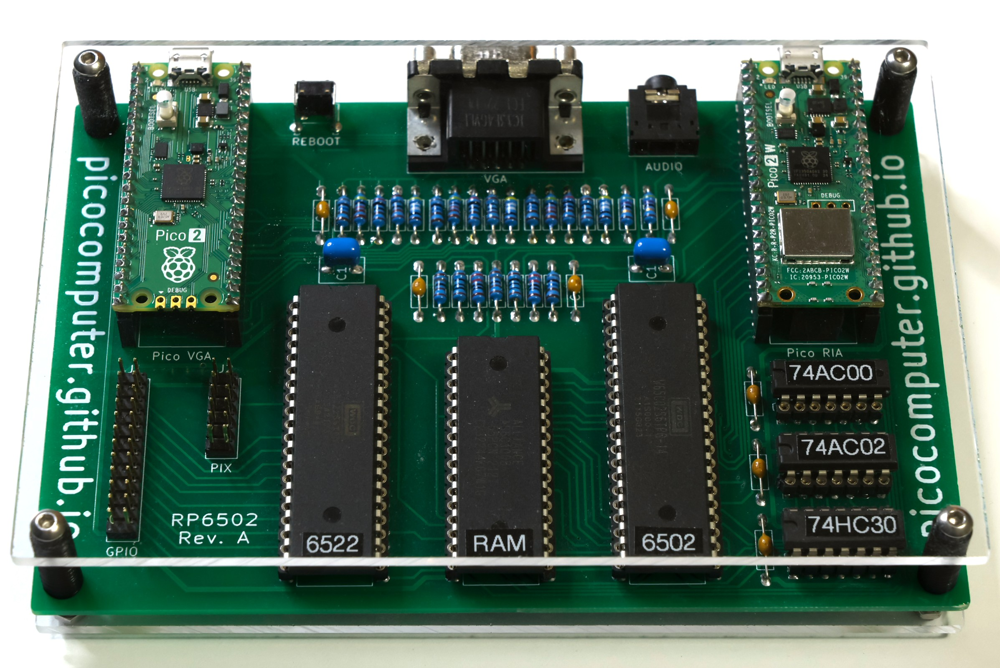

============================
RP6502-PICO
============================

RP6502 - Standalone Machine

The RP6502-PICO is the standalone machine, a 6502 computer you build
yourself. It is the original Picocomputer, and the project is named after
the Raspberry Pi Pico it was first built on. The machine is one circuit
board with a WDC 65C02, a WDC 65C22, a RAM chip, three logic chips and two
Raspberry Pi Pico 2 boards, which are the entire modern side of the
machine. One Pico runs the RP6502 Interface Adapter (:doc:`ria`) for USB,
storage and sound, and a Pico 2 W in that socket adds Wi-Fi and Bluetooth.
The other Pico runs the video system, the RP6502 Video Graphics Array
(:doc:`vga`).

Formally, a Pi Pico flashed with the RIA firmware is an RP6502-RIA, a Pi
Pico 2 W flashed with the RIA-W firmware is an RP6502-RIA-W, and a Pi Pico
flashed with the VGA firmware is an RP6502-VGA.

Programs run on the 65C02 at up to 8 MHz. The finished machine plugs into
a VGA monitor, or into an HDMI display with a VGA-to-HDMI cable.
Keyboards, mice, gamepads, flash drives, floppy drives and MIDI
instruments plug into the USB port of the RIA, directly or through a hub.
In VS Code, the RP6502-PICO launch configuration of the :doc:`sdk` builds
a program and runs it on the machine over USB or telnet.

The radio of the Pico 2 W adds Wi-Fi and Bluetooth LE. Keyboards, mice,
and gamepads connect without a cable. The real-time clock is set from
internet time servers. Over telnet, you can use the monitor and a running
program from any computer on the network, and build and run a project
from VS Code. A 6502 program can call a BBS through an emulated Hayes
modem, or answer incoming calls as a BBS. An RP6502-RIA has none of these.
The other machines use the Bluetooth of their host. Networking is only on
the RP6502-PICO today, and support for other machines is planned.

Schematic
=========

`RP6502-PICO <_static/2026-01-26-rp6502.pdf>`_ (pdf)

Buying an RP6502-PICO
=====================

To solder, or not to solder — that is the question. You can homebrew a 6502
today without ever touching a soldering iron. Choose your path.

- :doc:`pico-solder`
- :doc:`pico-socket`

.. _pico-console:

Console
=======

The console of an RP6502-PICO is on the :ref:`console manifold
<term-console-manifold>`, and a terminal can be attached in three ways:

* **VGA and USB keyboard.** In the standard configuration with a
  :doc:`vga` module, the console is accessed with a VGA monitor and a
  USB keyboard plugged into the RIA.
* **USB CDC ACM.** Connect the USB port on the VGA module to a computer
  and access the console over the USB CDC ACM serial port that appears.
  No driver is needed.
* **Telnet.** With a Pi Pico 2 W, the console is also on the network. See
  `Telnet Console`_ for setup.

5V Power is applied to the VGA module, enough for all your devices plus one
watt for the RP6502-PICO itself.

Inside the machine, the console is a UART between the RIA and the VGA
module: 115200 bps, 8-bit words, no parity, 1 stop bit.

The VGA terminal stops responding to the :ref:`size query
<term-terminal-size>` of the line editor if a telnet or USB terminal is
connected. **If both USB and
telnet terminals are connected at the same time and both reply, the
system may get confused.** If pagination or word-wrap seem wrong, check
what terminals are attached to the console manifold.

.. _pico-monitor:

Monitor
=======

A fresh RIA boots into the RP6502 monitor. It is not an operating-system
shell; think of it more like a UEFI shell. Its main job is loading ROMs,
with just enough hardware and locale configuration to get going — kept
deliberately minimal.

The monitor runs on the console, so it is reachable from any terminal on
the :ref:`console manifold <term-console-manifold>`.

The monitor's built-in help is extensive and always current. Type
``HELP`` to get started, then dig into deep help like ``HELP SET PHI2``.
The table lists every command.

.. list-table::
   :widths: 30 70
   :header-rows: 1

   * - Command
     - Description
   * - ``HELP (command|rom)``
     - Show the list of commands, the help of a command, or the
       :ref:`help text <sdk-assets>` of an installed ROM. ``H`` and ``?``
       are short forms.
   * - ``HELP ABOUT|SYSTEM``
     - Show the credits, or a guide to the monitor.
   * - ``STATUS``
     - Show the state of the system and of every connected device.
   * - ``SET (attr) (value)``
     - Show or change a setting. See `Settings`_.
   * - ``LS (dir|drive)``
     - List a directory. ``DIR`` is the same command.
   * - ``CD (dir)``
     - Show or change the current directory. ``CHDIR`` is the same
       command.
   * - ``0:`` to ``9:``
     - Change the current drive. ``MSC0:`` to ``MSC9:`` are the same.
   * - ``MKDIR dir``
     - Make a directory.
   * - ``UNLINK file|dir``
     - Delete a file or an empty directory. ``RM`` is the same command.
   * - ``COPY src dst``
     - Copy a file to a new name or into a directory. ``CP`` is the same
       command.
   * - ``MOVE src dst``
     - Rename a file or a directory, or move it on the same drive. ``MV``
       is the same command.
   * - ``DISK sub drv``
     - Show, label, format, erase, or verify a drive. See
       `Storage and ROMs`_.
   * - ``LOAD file``
     - Load a ROM file. The 6502 starts if the ROM has a reset vector.
   * - ``INFO file``
     - Show the :ref:`help text <sdk-assets>` of a ROM file.
   * - ``INSTALL file (rom)``
     - Install a ROM file in the flash of the RIA.
   * - ``rom``
     - Load and start an installed ROM.
   * - ``REMOVE rom``
     - Remove an installed ROM.
   * - ``RESET``
     - Start the 6502 at the current reset vector, $FFFC.
   * - ``REBOOT``
     - Restart the RIA. See `Reset and Reboot`_.
   * - ``FLASH file``
     - Flash a UF2 file to the RIA or the VGA. See `Firmware Updates`_.
   * - ``UPLOAD file``
     - Write a file. Binary chunks follow.
   * - ``BINARY addr len crc``
     - Write memory. Binary data follows.
   * - ``0000 (00 00 ...)``
     - Read or write memory. XRAM is at $10000-$1FFFF. ``HELP SYSTEM``
       shows examples.

Use the ``LOAD`` command to load ROMs in ``.rp6502`` format. A ROM
describes the state of the machine as it comes out of reset, and a
single ROM can hold every piece of code, video and audio a program
needs. Use ``INSTALL`` to put a ROM in flash; from there it can be run
directly, or ``SET BOOT`` will load it whenever the RIA boots. These
files are built with the :doc:`sdk`, where the :ref:`ROM File Format
<sdk-rom-file-format>` is documented.

A few monitor commands, such as ``UPLOAD`` and ``BINARY``, exist for
developer tools rather than for people. See the :doc:`sdk` for the tools
that use them.

Storage and ROMs
================

Files live on a USB flash drive. Any USB flash or floppy drive is read and
written as FAT. ExFAT is ready to go and will be enabled when the patents
expire. 1 MB of flash holds the ROMs you ``INSTALL``, and
``SET BOOT`` picks one to load at power-on. ROMs do not need to be installed,
they are intended to be loaded directly from mass storage devices.
USB drives are named ``MSC0:`` to ``MSC9:``, or ``0:`` to ``9:`` for
short, and installed ROMs are on the null drive, ``:``, where a ROM
installed as NAME is ``:NAME``.

The ``DISK`` commands work on a whole drive. ``FORMAT`` and ``ERASE`` ask
you to type YES before they start.

.. list-table::
   :widths: 30 70
   :header-rows: 1

   * - Command
     - Description
   * - ``DISK INFO drv``
     - Show the device, the format, and how full the drive is.
   * - ``DISK LABEL drv (lbl)``
     - Show or set the volume label.
   * - ``DISK FORMAT drv ...``
     - Create a filesystem. ``HELP DISK FORMAT`` lists the options.
   * - ``DISK ERASE drv``
     - Overwrite every sector with zeros.
   * - ``DISK VERIFY drv``
     - Read every sector and report the bad ones.

.. _pico-reset:

Reset and Reboot
================

While reset is low, the 6502 is stopped and the monitor is connected to
the console. Reset is mostly handled automatically, but the RP6502-PICO
also needs a way to stop a wedged 6502. Two monitor commands bring reset
high. Either ``LOAD`` a ROM that has a reset vector, or use the ``RESET``
command if you've prepared RAM some other way. To drop reset from high to
low and return to the monitor, even from a wedged 6502, use any terminal on
the :ref:`console manifold <term-console-manifold>`:

1. Press Ctrl-Alt-Del from a USB keyboard.
2. Send a break from a serial terminal.
3. Send a break from a telnet terminal.

The reboot button is wired to the RIA RUN pin. Rebooting restarts the RIA and
loads any configured boot ROM, just like at power-on. ``REBOOT`` does the
same. Never wire a button to RESB; the RIA must stay in control of it.

.. _pico-settings:

Settings
========

``SET`` with no arguments shows every setting, and ``HELP SET`` followed by
a setting gives its details. The RIA keeps the settings in its flash, so
they last through a reboot. A Pi Pico 2 W adds ``BLE`` and the settings of
`Wi-Fi Setup`_ and `Telnet Console`_.

.. list-table::
   :widths: 30 70
   :header-rows: 1

   * - Command
     - Description
   * - ``SET PHI2 (kHz)``
     - The 6502 clock, from 100 to 8000 kHz. A speed that is not available
       rounds up to the next one that is.
   * - ``SET BOOT (rom|-)``
     - The installed ROM that loads and starts at power-on and at reboot.
       ``-`` boots into the monitor.
   * - ``SET TZ (tz)``
     - The time zone. See `Network Time Protocol (NTP)`_.
   * - ``SET LOC (loc)``
     - The locale, ``EN``, ``FR``, or ``PL``, for the monitor and for
       ``strftime()``. While ``CP`` is 0, it also selects the code page.
   * - ``SET KB (layouts)``
     - One or more keyboard layouts, such as ``SET KB US US-INTL``.
       Super+Space cycles through them.
   * - ``SET CP (cp)``
     - The code page. 0, the default, follows ``LOC``. Any other value is
       fixed: 437, 720, 737, 771, 775, 850, 852, 855, 857, 860, 861, 862,
       863, 864, 865, 866, or 869.
   * - ``SET VGA (0|1|2)``
     - The display type: 0 for 640x480 on 4:3 displays, 1 for 16:9
       displays, with 1280x720 for the 16:9 canvases and 640x480 for the
       others, or 2 for 1280x1024 on 5:4 SXGA displays. Every canvas works
       on every display type. :ref:`Video Timing <vga-video-timing>` gives
       the timing of each.
   * - ``SET NFC (0|1|2|86)``
     - The NFC reader. See `Near Field Communications (NFC)`_.
   * - ``SET BLE (0|1|2|86)``
     - Bluetooth LE. See `Bluetooth`_.

Peripherals
===========

The RIA is a USB host. It drives keyboards, mice, gamepads, hubs, UART serial
adapters, MIDI instruments, NFC readers, and floppy and flash drives. The
firmware includes gamepad drivers for Generic HID, XInput, and PlayStation
controllers.

A Pi Pico 2 W adds Bluetooth LE for keyboards, mice, and gamepads. Wi-Fi 4
(802.11n) adds networking for modem emulation and NTP.

Bluetooth
=========

The RP6502-PICO supports Bluetooth LE (BLE) keyboards, mice, and
gamepads. Bluetooth Classic (BR/EDR) is not supported. BLE has been
everywhere since Bluetooth 4.0 (June 2010), so compatible devices are
easy to find, though the occasional oddball still turns up.

To add a device, run the monitor command ``SET BLE 2`` to enter pairing
mode; the LED on the RP6502-RIA-W blinks while it's pairing. Put your
device into its own pairing mode too. Check its manual, but it's
probably a button and some more blinking. When the blinking stops, the
device is connected and bonded, so it reconnects automatically from then
on.

Wi-Fi Setup
===========

The radio is configured from the monitor. Set the network name and the
password, and the radio connects. The ``STATUS`` command reports the state
of the connection.

.. list-table::
   :widths: 25 75
   :header-rows: 1

   * - Command
     - Description
   * - ``SET RF (0|1)``
     - Turn all radios on (1, the default) or off (0) without disturbing
       any other setting.
   * - ``SET RFCC (cc|-)``
     - The two-letter code for the country the radio operates in, such as
       ``US`` or ``GB``. The radio performs better when it is set than it
       does on the worldwide default, which ``-`` selects. Run ``HELP SET
       RFCC`` to list the supported codes.
   * - ``SET SSID (ssid|-)``
     - The SSID is the Service Set Identifier, which is the name of the
       network the radio joins. Run ``HELP SET SSID`` to scan for and list
       nearby networks, and use ``-`` to clear the name.
   * - ``SET PASS (pass|-)``
     - The password for the network. Use ``-`` to clear it.

Network Time Protocol (NTP)
===========================

The real-time clock synchronizes with internet time servers whenever
Wi-Fi is connected. The ``STATUS`` command reports what NTP is doing.

The clock keeps UTC. Set your time zone with ``SET TZ`` for local time,
and run ``HELP SET TZ`` for guidance. Daylight Saving is applied
automatically where the locale observes it.

.. _pico-telnet-console:

Telnet Console
==============

The console can be exposed over the network. A telnet client is then a
console like any other, for the monitor and for a running 6502. The
traffic is unencrypted, so anything typed or printed can be read along
the way, including the key.

.. list-table::
   :widths: 25 75
   :header-rows: 1

   * - Command
     - Description
   * - ``SET PORT (port|0)``
     - The TCP port to listen on. The default is ``23``, the standard
       telnet port; ``0`` disables the telnet console.
   * - ``SET KEY (key|-)``
     - The passkey a client sends to connect. Use ``-`` to clear it.

The telnet console starts listening once ``KEY`` is set and ``PORT`` is
non-zero.

Modem Emulation
===============

The RP6502-PICO emulates a Hayes modem — the classic AT command set —
for reaching BBSes (bulletin board systems). It places outgoing calls
and answers incoming ones over either raw TCP or telnet. As with the
telnet console, the connection is unencrypted.

Example AT commands:

- ``ATA`` — Answer incoming call
- ``ATDexample.com:23`` — Dial a BBS by address
- ``ATDS=0`` — Dial phonebook entry (0-3)
- ``+++`` — Escape back to command mode
- ``ATE1`` — Set echo
- ``ATH`` — Hang up
- ``ATO`` — Return to call
- ``ATQ0`` — Set quieting
- ``ATSxxx?`` — Query register number xxx
- ``ATSxxx=yyy`` — Set register number xxx with value yyy
- ``ATV1`` — Set verbosity
- ``ATX0`` — Set progress messaging
- ``ATZ`` — Load profile from flash
- ``AT&F`` — Load factory profile
- ``AT&V`` — View profile, stored profile, phonebook, and network
- ``AT&W`` — Write profile to flash
- ``AT&Z0=example.com:23`` — Save phonebook entry (0-3) to flash
- ``AT\L=23`` and ``AT\L?`` — Listen port for ``ATA`` (0 disables)
- ``AT\N0`` or ``AT\N1`` and ``AT\N?`` — Network mode: 0=raw TCP, 1=telnet
- ``AT\T=ANSI`` and ``AT\T?`` — Terminal type advertised during telnet
  negotiation
- ``AT+RFCC=US``, ``AT+RFCC?``, and ``AT+RFCC!`` — Access RIA setting RFCC
- ``AT+SSID=your_ssid``, ``AT+SSID?``, and ``AT+SSID!`` — Access RIA
  setting SSID
- ``AT+PASS=your_pass`` and ``AT+PASS?`` — Access RIA setting PASS

Each ``AT+`` setting uses ``=`` to set, ``?`` to query the current value,
and ``!`` to list (``AT+SSID!`` scans for nearby networks, ``AT+RFCC!``
lists supported country codes). Lists word-wrap to 80 columns.

The modem is available as a set of special device names:

- ``AT:`` is transient. It starts from factory defaults, has no
  phonebook, and ``AT&W`` has nothing to save.
- ``AT0:`` through ``AT9:`` are ten independent profiles, each with its
  own flash-backed settings and four-slot phonebook (``AT&Z0``-``AT&Z3``).

When you open a numbered device, it loads its saved profile. ``AT&W``
writes the profile back, ``ATZ`` reloads it, and ``AT&F`` restores
factory defaults. Up to four modem devices can be open and in use at
once.

The ``AT+`` commands (``+RFCC``, ``+SSID``, ``+PASS``) pass straight
through to the global RIA settings and take effect immediately, no matter
which modem device is open.

Virtual COM Port
================

If you need serial ports beyond the console UART, USB adapters are
available for CMOS/TTL, RS-232, RS-422, and RS-485, and each one appears
as a Virtual COM Port (VCP). RP6502-PICO firmware includes drivers for FTDI,
CP210X, CH34X, PL2303, and CDC ACM.

The ``STATUS`` command lists any connected VCP devices. Open one like a
file, using a special name. By default ``"VCP0:"`` opens at 115200 bps
with 8 data bits, no parity, and 1 stop bit. Set the baud rate with
``"VCP0:115200"``, or the full bit configuration with
``"VCP0:115200,8N1"``. The file won't open if your hardware can't
support the requested configuration.

.. code-block:: C

  open("VCP0:1200,7E2", O_RDWR);
  // then read and write

Generous FIFO buffers serve both directions, and both reads and writes
are non-blocking. Reads can return 0 bytes, and writes may send less than
you asked for — resubmit any remaining bytes on a later call.

MIDI
====

MIDI instruments attached to the machine appear as devices, and the
``STATUS`` command lists them. RP6502-PICO firmware includes a USB MIDI
host driver, so a USB instrument plugs right in. Each virtual cable is
its own device — ``"MIDI0:"`` onward, assigned in the order cables
appear, up to four at a time. A simple keyboard is one cable (1X1); a
multi-port interface is several. Open one like a file.

A cable opens in one of two modes, chosen by the open name. Bare
``"MIDI0:"`` is **raw** — reads and writes are plain wire MIDI, the same
bytes a 5-pin DIN cable carries, with no timing and nothing added or
removed. Give a division instead, ``"MIDI0:480"``, and the cable is
**timed**: the RIA handles timing for you using the event format from
Standard MIDI Files, prefixing every message with a variable length
quantity delta time measured in ticks. The rest of this section is the
timed format.

In timed mode, time starts at the open. The first byte in either
direction is a delta measuring from the open itself, and a delta of zero
means right now. Writes are scheduled — the RIA holds each message and
sends it to the instrument exactly on time, so your program only needs to
keep the buffer fed. Reads are a recording — incoming messages arrive
with delta times measuring when they actually happened, ready to store in
a file or play back later.

The division is ticks per quarter note, the value an SMF carries in its header.
It accepts 1 to 32767 and is fixed while open; reopen between songs to change
it. A cable can be input, output, or both; reading an output-only cable or
writing an input-only one returns an error.

Tempo changes on the fly with the standard SMF Set Tempo meta event,
which the RIA consumes locally and never forwards to the instrument. The
event is ``FF``, a type, a length, then that many data bytes:

.. list-table::
   :widths: 32 68
   :header-rows: 1

   * - Control event
     - Effect
   * - ``FF 51 03 tt tt tt``
     - Set tempo in microseconds per quarter note — the standard SMF
       event. The tick rate becomes tempo × 1000 ÷ division.
   * - ``FF FF``
     - A wire System Reset. The doubled escape is the whole event, with no
       length byte. Unlike the others, it is sent to the instrument.

Tempo defaults to 500000 µs per quarter note — 120 BPM, a 1041667 ns
tick at 480 PPQN. Every other ``FF`` event, including the rest of the
SMF meta set, is swallowed without effect, so a Standard MIDI File track
plays through nearly verbatim — division from the file header, tempo
events straight from the track:

.. code-block:: C

  open("MIDI0:96", O_RDWR); // division from the MThd header
  // FF 51 03 07 A1 20  tempo = 500000 (120 BPM at 96 PPQN)
  // then delta-timed events; the RIA paces them and tracks tempo changes

The RIA echoes every tempo event onto the read stream at the moment it
takes effect, so a recording is self-describing. A rejected event is
malformed, or carries a value of zero or out of range. The RIA echoes it
with its value zeroed and the tempo unchanged; zero is never a valid tempo,
so it unambiguously marks an event that didn't apply. Your read parser must
handle ``FF``: a second ``FF`` is a System Reset, and anything else is
a meta type and length to skip.

The stream carries raw wire MIDI messages after each delta time: channel
voice messages (running status accepted on writes), system common, and
single-byte real-time messages F8-FE. System Reset travels as the
``FF FF`` escape in both directions: write a delta then ``FF FF`` to
send one, and a reset from the instrument is recorded the same way. The
undefined bytes F4 and F5 are quietly dropped.

System Exclusive, or sysex, is how instruments move the big stuff, like
patch banks and sample dumps, in one long message: ``F0``, any number of
data bytes, then ``F7`` to finish. Only the opening ``F0`` takes a delta
time; the data bytes flow without timing until the ``F7``, on writes and
recordings alike. Real MIDI lets real-time messages like clock barge
into the middle of a sysex — the RIA passes them through in place, so
expect the occasional F8-FE byte inside a recorded dump. And if a tempo
echo comes due during a dump, the recording closes the sysex early and
reopens it after — everything arrives, just split into two
``F0`` ... ``F7`` fragments.

Delta times measure from the previous event, so timing stays exact over
any song length. Events are anchored to an absolute tick count, and
ticks are kept internally in nanoseconds, holding arithmetic rounding
below one part per million. The error left over comes from the machine's
clock and transport. Where the RIA is paced by a crystal-driven microsecond
timer and delivers over USB full speed, the crystal drifts single-digit
milliseconds over a several-minute song and framing sets the
moment-to-moment jitter near one millisecond — the same pace as the
classic MIDI wire itself.

If your program stops feeding the buffer and resumes, messages already
past due play immediately and the timeline continues from there. If you
stop reading, the recording drops whole messages rather than backing up,
and the timing of everything that survives stays exact. Reads and writes
are non-blocking with the same short read/write rules as other
non-blocking devices.

Closing a timed output cable blocks until its buffered tail has played
out on schedule. The final notes reach the instrument before close returns,
along with the note-offs that end them, and nothing is left ringing.
``sync`` does the same without closing. It waits for the schedule to catch
up between songs. Both follow the timeline, so a far-future delta
still in the buffer makes them wait that long. If a sysex is still open
when a timed cable closes, the RIA sends its ``F7`` so the instrument is
not left waiting mid-dump. A raw cable has no schedule, so close and
``sync`` flush what is buffered, and they inject no ``F7``.

.. _pico-nfc:

Near Field Communications (NFC)
===============================

NFC cards have become a popular media replacement in the retro
community, and they map neatly onto the RP6502's use of "ROM files" in
place of "ROM cartridges". In 1983 you might have grabbed a cartridge
with colorful stickers to home in on the exact dopamine hit you were
after. NFC cards are cheap and just as easy to decorate, whether with
stickers or direct printing. Grab a card, tap it on the reader, and the
ROM you want loads instantly.

You'll need a PN532 card reader with a USB interface. It's the only
reader RIA firmware drives, and it's cheap — around $10 USD. You'll also want a
card (or fob, or sticker) for each ROM you plan to support. New to NFC?
Buy a pack of NTAG215 cards and a sharpie.

Do **not** buy a kit of separate USB-to-UART and PN532 boards unless you
want an unsupported project on your hands. Buy a single board with
everything already engineered and ready to use.

With the reader plugged in, run the monitor command ``SET NFC 2`` to
start USB detection. It may probe your other VCP devices with PN532 data
along the way; that's normal. You'll hear an error buzz, or two beeps for
success. You can also run ``STATUS`` to see whether ``(NFC)`` is listed
next to one of your VCP devices.

``SET NFC 1`` turns the reader on and ``SET NFC 0`` turns it off; the
choice persists across reboots (a successful ``SET NFC 2`` also leaves it
on). ``SET NFC 86`` forgets the paired reader so a later ``SET NFC 2`` can
pair a different one.

From now on, scanning a card produces one of three sounds: an error buzz
if something went wrong, two beeps for success, or a single beep for a
partial success.

Program each card with the filename and arguments of the ROM to launch.
If you'd load the ROM with ``LOAD /jigsaw.rp6502``, put an NDEF TEXT
record on the card holding just ``/jigsaw.rp6502`` — no load command. A
leading ``/`` is implied if you leave it off, and the current working
directory is ignored.

Paths with spaces need quotes, and you can include arguments:
``"/My Games/jigsaw.rp6502" cat.bmp``

When a card is read, every mounted drive is scanned for the ROM file. On
a match, you get two beeps, the 6502 stops, the current drive and
directory switch to the ROM's location, and the new ROM starts loading.
If that ROM is already running, you get a single beep and nothing else
happens.

To search just one drive, name it in the text record:
``MSC0:/encabulator.rp6502``

A card may also name an installed ROM, ``:NAME``. That ROM launches the
same way, with the same beeps, except that no drive is scanned and the
current drive and directory stay where they are. A name that is not
installed gives the error buzz.

NFC Device API
--------------

Applications can take over the NFC reader for advanced uses, or to help
program NFC tags. While the ``"NFC:"`` device is open, automatic ROM
launching is suppressed.

.. code-block:: text

   int fd = open("NFC:", O_RDWR);

The PN532 reader runs autonomously on the RIA. The 6502 arms operations
with ``write()`` and polls results with ``read()``: ``NFC_CMD_READ``
returns the current tag data immediately, ``NFC_CMD_WRITE`` arms a write,
and ``NFC_CMD_CANCEL`` disarms a pending one. State changes and write
completions are posted to ``read()`` automatically.

write() -- Commands
~~~~~~~~~~~~~~~~~~~

``write()`` is non-blocking and streaming. A call may consume less than
you passed; resubmit the remaining bytes on a later call.

.. list-table::
   :widths: 40 60
   :header-rows: 1

   * - Byte
     - Command
   * - ``NFC_CMD_WRITE`` (0x01), page, lenLo, lenHi, tag data...
     - Arm a write
   * - ``NFC_CMD_CANCEL`` (0x02)
     - Disarm pending write
   * - ``NFC_CMD_READ`` (0x03)
     - Return current tag data
   * - ``NFC_CMD_SUCCESS1`` (0x04)
     - Play success tone 1
   * - ``NFC_CMD_SUCCESS2`` (0x05)
     - Play success tone 2
   * - ``NFC_CMD_ERROR`` (0x06)
     - Play error tone

The ``NFC_CMD_WRITE`` payload starts with the start page, a two-byte
length, then the tag data. ``page`` is the NTAG page to begin writing at
(page 4 is the start of user data). Data is written in 4-byte pages, and
the final page is zero-padded if the payload isn't a multiple of 4. The
write arms once the full payload arrives and runs on the current card or
the next one presented. A second ``NFC_CMD_WRITE`` overwrites the first.

The payload may be at most 888 bytes; a longer length is rejected with the
error tone and never armed. A write also fails (error tone) if it would run
past the card's NDEF data area or target a page below 4, and a zero-length
payload completes immediately as a no-op.

``NFC_CMD_READ`` always returns ``NFC_RESP_READ`` on the next ``read()``;
if no card data is available, the length is zero.

read() -- Responses
~~~~~~~~~~~~~~~~~~~

``read()`` is non-blocking and streaming. It returns 0 bytes when there's
nothing new. Responses may be split across multiple calls, so callers
must buffer and reassemble them. State changes are sent once per change,
including once right after ``open()``. Only the latest state is tracked, so
a rapid transition (such as ``NFC_RESP_CARD_INSERTED`` immediately followed
by ``NFC_RESP_CARD_READY``) may be coalesced to the later state if you don't
``read()`` in between.

.. list-table::
   :widths: 40 60
   :header-rows: 1

   * - Byte
     - Meaning
   * - ``NFC_RESP_READ`` (0x01), lenLo, lenHi, tag data...
     - Read result
   * - ``NFC_RESP_WRITE`` (0x02)
     - Armed write complete
   * - ``NFC_RESP_NO_READER`` (0x03)
     - State: no reader attached
   * - ``NFC_RESP_NO_CARD`` (0x04)
     - State: no card present
   * - ``NFC_RESP_CARD_INSERTED`` (0x05)
     - State: card present, tag data not ready
   * - ``NFC_RESP_CARD_READY`` (0x06)
     - State: card present, tag data ready

The ``NFC_RESP_READ`` payload is a two-byte length followed by raw tag
data starting at page 0, and it may span multiple ``read()`` calls.
In the page layout, pages 0-2 are UID/lock bytes, page 3 is the Capability
Container (CC[2] * 8 = max NDEF bytes), and pages 4+ are user data
(TLV-wrapped NDEF records terminated with ``0xFE``).

After ``NFC_RESP_READ`` or ``NFC_RESP_WRITE``, send one or more tone
commands or play your own sounds. Typically you request reads on
``NFC_RESP_CARD_READY`` and arm writes on ``NFC_RESP_NO_CARD``, but you
can also arm a write after reading and verifying a card. The cached
tag image is not refreshed by a write, so re-present the card before the
next ``NFC_CMD_READ`` if you want to read back what you wrote.

.. _pico-firmware-updates:

Firmware Updates
================

Download the `pico zip
<https://github.com/picocomputer/rp6502/releases/latest>`_ and unpack the
UF2 files inside it. The VGA file is the same for everyone. The RIA file
depends on which Pi Pico you have. Use the "-w" if you have a Pi Pico 2 W.

Updates don't need BOOTSEL. Put the UF2 files on a USB drive, plug it into
the RIA, and flash both from the monitor. The system reboots after each
one.

.. code-block:: text

  FLASH rp6502-<version>-ria-w.uf2
  FLASH rp6502-<version>-vga.uf2

It is not possible to "brick" a Pi Pico from a failed flash. You can always
recover with the BOOTSEL method: hold the BOOTSEL button of the Pi Pico
while plugging it into a computer, and copy the UF2 file to the storage
device that appears.

.. _pico-pix:

PIX Physical Layer
==================

None of this is needed to program the machine. What follows is the bus
itself, for anyone building a device to put on it.

On the RP6502-PICO, PIX is a physical bus between the RP6502-RIA and the
RP6502-VGA. High-bandwidth devices like video systems need a bus of their
own. PIX is that bus: an addressable broadcast system that any number of
devices can receive, narrow enough to fit the GPIO budget of a Raspberry
Pi Pico, wide enough to move data as fast as the 6502 writes.

The signals are PHI2 and PIX0-3. This is a double-data-rate bus. It
shifts PIX0-3 left on both transitions of PHI2, so a 32-bit frame is
sent in just 4 PHI2 cycles. A PIO block on a Raspberry Pi Pico decodes
it, since PIO is essentially a shift register.

Bit 28 (0x10000000) is the framing bit, set in every message. When the
bus is idle, an all-zero payload repeats on device ID 7. A receiver
synchronizes by checking that PIX0 is high on a falling transition of
PHI2; if it isn't, stall until the next clock cycle.

Bits 31-29 (0xE0000000) hold the device ID of a message:

- **Device 0** — XRAM broadcasts only. The extended registers of device
  0 are handled inside the RIA and are never sent on the bus.
- **Device 1** — the :doc:`vga`.
- **Devices 2-6** — open for user expansion.
- **Device 7** — synchronization. (0xF0000000 is hard to miss on test
  equipment.)

For devices 1-6, the remaining bits address an extended register:

- **Bits 27-24** (0x0F000000) — the channel ID; each device can have 16
  channels.
- **Bits 23-16** (0x00FF0000) — the index of the register within that
  channel.
- **Bits 15-0** (0x0000FFFF) — the value to store in the register.

The RIA broadcasts every change to XRAM as a device 0 message, with the
XRAM address in bits 15-0 and the XRAM data in bits 23-16. Each device
keeps a local replica of the XRAM it uses, typically all 64 KB.

.. _pico-backchannel:

Backchannel
-----------

The RP6502-PICO hardware is constrained by GPIO pins, which is why it
uses two Raspberry Pi Pico 2 boards. The backchannel is a hack to
recover a single pin. The 6502 programmer never has to think about any
of this.

Because the PIX bus is unidirectional, the VGA system can't send data
straight back to the RIA. The UART Rx path won't do either — it would
add framing overhead or unusable control characters. But the PIX bus has
plenty of idle bandwidth (it only carries data when the 6502 writes to
XRAM), so all Tx data is routed over PIX, leaving the UART Tx pin free to
reverse directions and serve as the backchannel.

Values 0x00 to 0x7F send a version string as ASCII, terminated by 0x0D
or 0x0A. Sent immediately after the :ref:`backchannel-enable message
<vga-control-channel>` arrives for it to appear in the boot message.

When bit 0x80 is set, the 0x70 bits give the command type and the 0x0F
bits give a scalar for that command.

0x80 VSYNC - The scalar will increment and be used for the LSB of the
:ref:`RIA VSYNC <ria-registers>` register.

0x90 OP_ACK - Some XREG locations are triggers for remote calls which
may fail or take time to complete. This acknowledges a successful
completion.

0xA0 OP_NAK - This acknowledges a failure.

Because waiting for an entire character to decode over UART is lost time
for VSYNC, a predictive algorithm suspends ACK/NAK around the expected
window for a VSYNC so it can be edge triggered on the first bit.
