============================
SDK
============================

Software Development Kit

Introduction
============

The distribution format of a Picocomputer program is the ROM: one file
that ends in ``.rp6502``, such as ``game.rp6502``. A ROM describes the
state of the machine as it comes out of reset: the program and data are
in memory, and the reset vector points to where the program begins. One
ROM can hold all the code, video, and sound of a program.

A ROM is similar by design to the cartridge ROM of a game console and to
the BASIC ROM of an 8-bit home computer.

The SDK builds a ROM, runs it with the :doc:`emu`, an :doc:`pico`, or
the :doc:`web`, and debugs it in the :doc:`emu` while it runs. A project
starts as a copy of the `RP6502 project template
<https://github.com/picocomputer/rp6502-sdk>`__, which builds with
either of two 6502 compilers, cc65 or llvm-mos. The template includes the
same "Hello, world!" program four times: in C, in the assembly syntax of
cc65, in the assembly syntax of llvm-mos, and in BASIC. The C program
builds with either compiler.

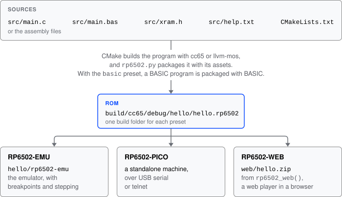
         src/xram.h, src/help.txt, and CMakeLists.txt. CMake builds the
         program with cc65 or llvm-mos. Then rp6502.py packages the
         program and its assets into the ROM, such as
         build/cc65/debug/hello/hello.rp6502, in the build directory of
         the preset. With the basic preset, rp6502.py packages a BASIC
         program with BASIC. RP6502-EMU, the emulator, runs the ROM with
         breakpoints and stepping. RP6502-PICO, a standalone machine that
         connects over USB serial or telnet, runs the ROM. RP6502-WEB runs
         the ROM in a browser from web/hello.zip, a web player that
         rp6502_web() makes.

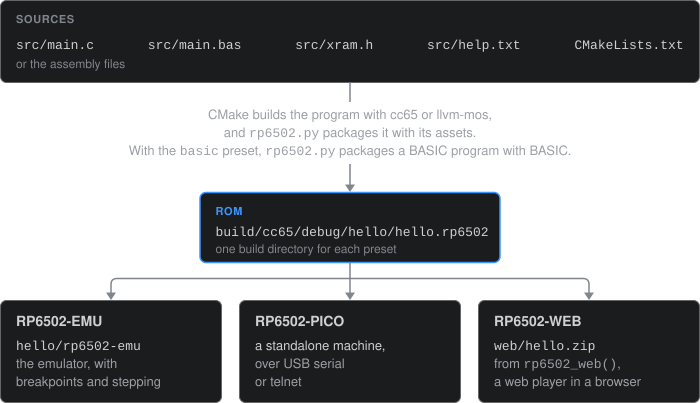
         src/xram.h, src/help.txt, and CMakeLists.txt. CMake builds the
         program with cc65 or llvm-mos. Then rp6502.py packages the
         program and its assets into the ROM, such as
         build/cc65/debug/hello/hello.rp6502, in the build directory of
         the preset. With the basic preset, rp6502.py packages a BASIC
         program with BASIC. RP6502-EMU, the emulator, runs the ROM with
         breakpoints and stepping. RP6502-PICO, a standalone machine that
         connects over USB serial or telnet, runs the ROM. RP6502-WEB runs
         the ROM in a browser from web/hello.zip, a web player that
         rp6502_web() makes.

.. _sdk-install:

Installing the Prerequisites
============================

Building Picocomputer programs requires VS Code, CMake 3.28 or later,
Python 3, git, Make or Ninja, and one or both of the 6502 compilers, cc65
and llvm-mos. Only the compilers must be recent. New Picocomputer
features often go into cc65 and llvm-mos before their next release. The
versions in package managers such as apt and Homebrew are too old.

The commands in this section are a tested recommendation. You may
install the prerequisites in another way. To install a compiler in
another way, first check the `Picocomputer GitHub page
<https://github.com/picocomputer?view_as=public>`__. It shows whether to
use the upstream project or the Picocomputer fork of it, and why.

The command for each compiler puts the compiler in the ``.rp6502``
directory of the home directory and adds its ``bin`` directory to PATH.
Run the command again to update the compiler.

Windows
-------

Open PowerShell. Install the prerequisites with winget:

.. code-block:: powershell

   winget install -e --id Git.Git
   winget install -e --id Kitware.CMake
   winget install -e --id Ninja-build.Ninja
   winget install -e --id Microsoft.VisualStudioCode
   winget install -e --id Python.PythonInstallManager

Close PowerShell. Then open it again, so that the new PATH takes effect.
Run these commands, which install Python, make Ninja the build tool,
and install the compilers:

.. code-block:: powershell

   pymanager install default
   setx CMAKE_GENERATOR Ninja
   irm https://raw.githubusercontent.com/picocomputer/.github/main/install/cc65.ps1 | iex
   irm https://raw.githubusercontent.com/picocomputer/.github/main/install/llvm-mos.ps1 | iex

On Windows, CMake defaults to a Visual Studio or NMake generator, which
does not work with cc65 or llvm-mos. ``CMAKE_GENERATOR`` selects Ninja
instead. For a project configured before this step, run "CMake: Delete
Cache and Reconfigure" from the VS Code Command Palette.

Close every PowerShell and VS Code window before the next step. If a
command is still not found, sign out of Windows and sign in again.

In WSL, follow the Linux steps instead.

macOS
-----

Open Terminal. Install Apple's command line tools, which include git,
Make, and Python 3:

.. code-block:: sh

   xcode-select --install

Download the universal disk image of `CMake
<https://cmake.org/download/>`__ for macOS. Drag CMake to Applications.
Then add its command-line tools:

.. code-block:: sh

   sudo "/Applications/CMake.app/Contents/bin/cmake-gui" --install

Download `VS Code <https://code.visualstudio.com/download>`__. Drag it to
Applications. Then install the compilers:

.. code-block:: sh

   curl -fsSL https://raw.githubusercontent.com/picocomputer/.github/main/install/cc65.sh | sh
   curl -fsSL https://raw.githubusercontent.com/picocomputer/.github/main/install/llvm-mos.sh | sh

VS Code reads PATH only when it starts. Quit VS Code with Cmd+Q. Then
open VS Code again.

Linux
-----

On Ubuntu and Debian, install the prerequisites with apt. Ubuntu 24.04,
Debian 13, and their later versions have CMake 3.28 or later.

.. code-block:: sh

   sudo apt install git cmake build-essential python3 curl

Download the ``.deb`` of `VS Code
<https://code.visualstudio.com/download>`__. Install it from the
directory that holds it:

.. code-block:: sh

   sudo apt install ./code_*.deb

In WSL, you do not need to install this ``.deb`` if you use VS Code for
Windows.

Run these commands, which give the user account access to the USB
serial port of an RP6502-PICO and install the compilers:

.. code-block:: sh

   sudo usermod -a -G dialout $USER
   curl -fsSL https://raw.githubusercontent.com/picocomputer/.github/main/install/cc65.sh | sh
   curl -fsSL https://raw.githubusercontent.com/picocomputer/.github/main/install/llvm-mos.sh | sh

Restart the login session, so that the new group and PATH take effect.

Getting Started
===============

Install the prerequisites first. The steps are in `Installing the
Prerequisites`_.

**1. Make a project.** On the GitHub page of the template, select "Use
this template". Then select "Create a new repository". GitHub creates a
new repository with a copy of the template. These commands clone the
repository and open its directory in VS Code:

.. code-block:: sh

   git clone https://github.com/<user>/my-project.git
   cd my-project
   code .

**2. Install the recommended extensions** when VS Code prompts for them:

- the C/C++ Extension Pack, which includes CMake Tools, to build;
- LLDB DAP, to debug in the emulator;
- Python Debugger, to run ``tools/rp6502.py``.

**3. Choose a configure preset.** The first time the project opens,
CMake Tools lists five presets. Four are for C or assembly:
``cc65/Debug``, ``cc65/Release``, ``llvm-mos/Debug``, and
``llvm-mos/Release``. Choose a Debug preset, because breakpoints and
stepping require debug information. A Release preset builds an optimized
ROM for distribution. The fifth preset, ``basic``, is for BASIC. To
change the preset later, use the Configure row of the CMake view of the
Side Bar.

A C program goes in ``src/main.c``, and a BASIC program goes in
``src/main.bas``. To write in assembly, replace ``src/main.c`` in
``CMakeLists.txt`` with ``src/main-cc65.s`` for cc65 or
``src/main-llvm-mos.s`` for llvm-mos.

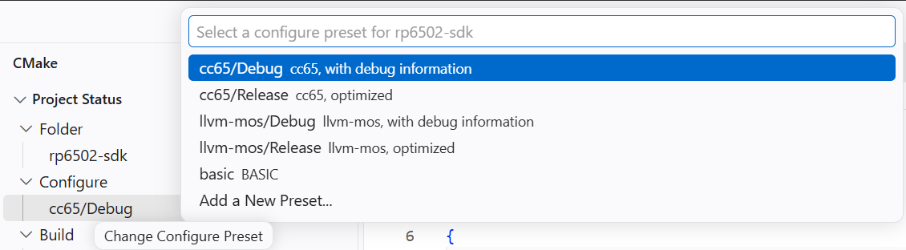
         cc65/Release, llvm-mos/Debug, llvm-mos/Release, and basic, above
         the Configure row of the CMake view of the Side Bar.

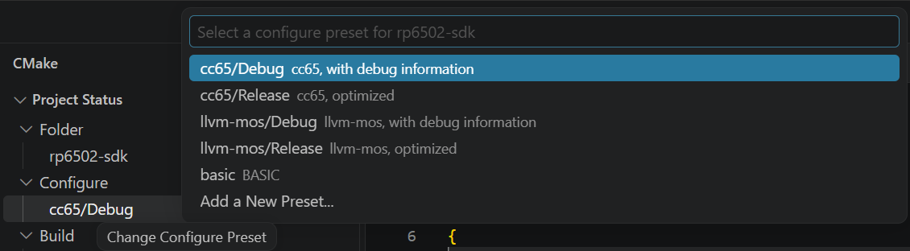
         cc65/Release, llvm-mos/Debug, llvm-mos/Release, and basic, above
         the Configure row of the CMake view of the Side Bar.

The first configure downloads the tools into ``tools/``.

**4. Press F5 to debug.** VS Code builds ``hello.rp6502`` and runs it in
the emulator. "Hello, world!" appears in the emulator window and in the
Debug Console of VS Code. The session stays open after the ROM exits, so
the emulator window keeps its output. Stop the session with Shift+F5.
The emulator window can open behind VS Code.

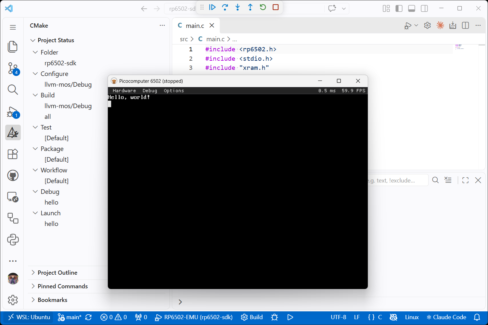
         with its debug toolbar.

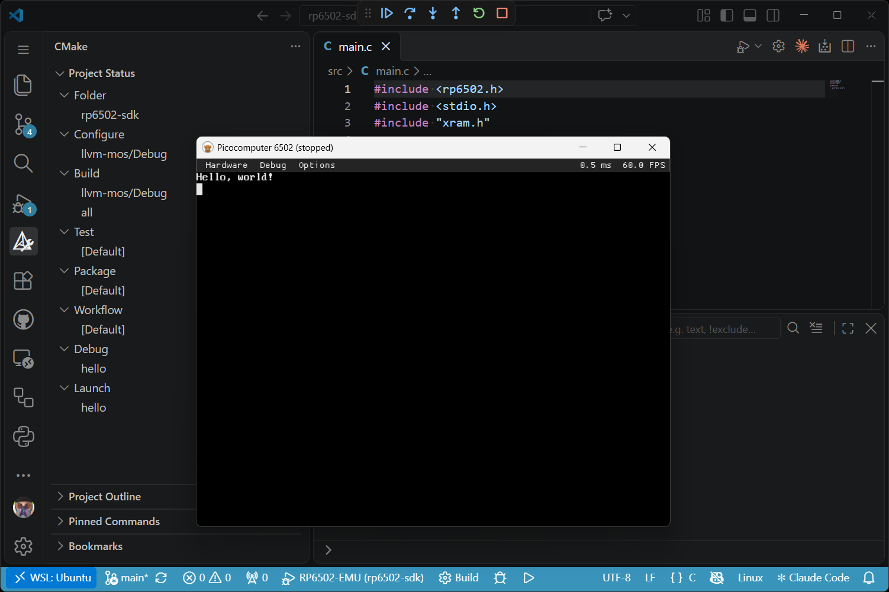
         with its debug toolbar.

The project now looks like this:

.. code-block:: text

   my-project/
   ├── CMakeLists.txt         the ROMs this project builds
   ├── CMakePresets.json      the five configure presets
   ├── README.md              web player link, requirements, updating
   ├── .github/               GitHub Pages workflows
   ├── .vscode/               F5 configurations, tasks, extensions
   ├── src/
   │   ├── main.c             Hello, world! in C
   │   ├── main-cc65.s        the same in cc65 assembly
   │   ├── main-llvm-mos.s    the same in llvm-mos assembly
   │   ├── main.bas           the same in BASIC
   │   ├── xram.h             the XRAM layout
   │   └── help.txt           the help asset
   ├── tools/                 the tools that build and test
   │   ├── rp6502.cmake
   │   ├── rp6502.py
   │   ├── cc65-toolchain.cmake
   │   ├── cc65-config.cmake
   │   ├── rp6502-0.40-linux-x86_64.tar.gz
   │   └── rp6502-0.40-web.zip
   ├── build/                 build output, ignored by git
   └── .rp6502                the settings file, ignored by git

Your new project supports every compiler and language. You may keep all
of it, or change it in any way. When you choose one compiler and
language, these changes remove the parts you do not use:

- In ``CMakeLists.txt``, ``if(RP6502_BASIC)`` has a branch for BASIC and a
  branch for C. Keep the branch you use, and delete the other branch.
- Delete the presets and the source files that the project does not use.

Commit ``tools/`` with the project. Git ignores some of its files on
purpose. To learn which ones and why, read `Updating the Tools`_.

Running and Debugging
=====================

"Start Debugging" (F5) runs one of three launch configurations. Choose
one in the Run and Debug view of the Side Bar.

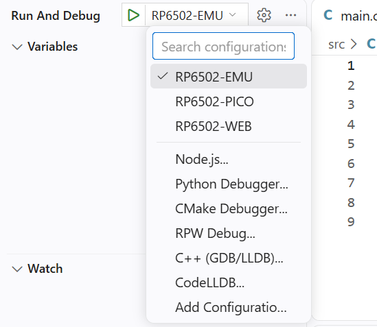
         Side Bar, with "RP6502-EMU", "RP6502-PICO", and "RP6502-WEB".

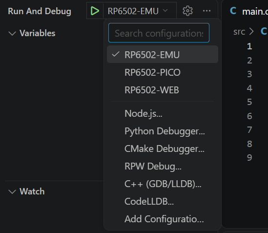
         Side Bar, with "RP6502-EMU", "RP6502-PICO", and "RP6502-WEB".

The **RP6502-EMU** launch configuration is the default. It builds the
project and runs the ROM in the :doc:`emu` with :ref:`source-level
debugging <emu-debugging>`.

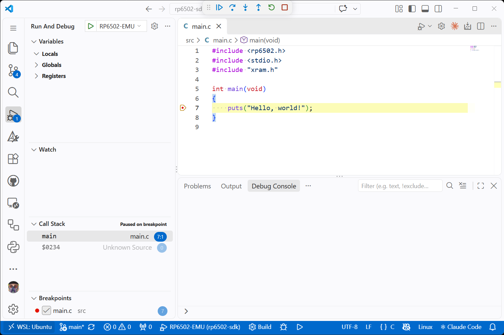
         Call Stack panels.

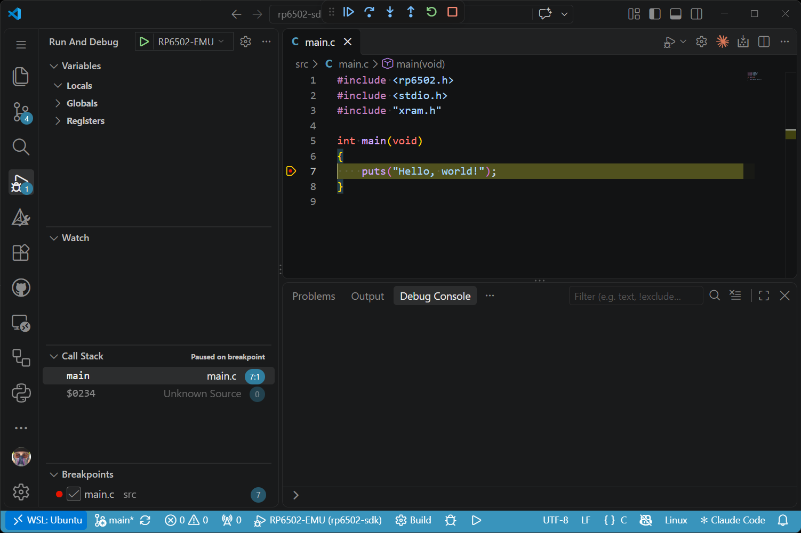
         Call Stack panels.

The **RP6502-PICO** launch configuration builds the project and runs the
ROM on an :doc:`pico`. It uploads the ROM to the RP6502-PICO, then runs
it from there. The upload replaces any file with the same name. The
console opens in the VS Code Terminal panel. The RP6502-PICO has no
breakpoints or stepping, so a common debugging technique is ``printf()``
to the console.

An RP6502-PICO may connect through the USB port of the VGA module or
over :ref:`telnet <pico-telnet-console>`, so the launch configuration
requires a setting for the connection. Its first run fills in a hint for
``device`` in the `settings file <RP6502-PICO_>`_. Unless your RP6502-PICO
happens to be on that port, the run fails with an error until you set
``device``.

The **RP6502-WEB** launch configuration builds the project and opens a
page in a browser. The page has a link to every `web player <Web
Players_>`_ that ``rp6502_web()`` makes.

Building a ROM
==============

``CMakeLists.txt`` describes the ROMs a project builds. This listing is
the C branch of the ``CMakeLists.txt`` of a new project, without the
``if()``. A BASIC project calls ``rp6502_basic()`` instead of
``rp6502_executable()``. Learn about it in `BASIC Programs`_, the next
section.

.. code-block:: cmake

  cmake_minimum_required(VERSION 3.28)

  include(${CMAKE_CURRENT_LIST_DIR}/tools/rp6502.cmake)

  project(MY-RP6502-PROJECT C CXX ASM)

  add_executable(hello)
  rp6502_align(hello "XRAM_.*")
  rp6502_asset(hello help src/help.txt)
  rp6502_executable(hello DATA default RESET default)
  rp6502_web(hello)
  target_sources(hello PRIVATE
      src/main.c
  )

- ``include()`` loads the RP6502 CMake functions from ``tools/``.
- ``project()`` names the project and the languages it compiles. Change
  ``MY-RP6502-PROJECT`` to any name.
- ``add_executable(hello)`` creates the program, a CMake target named
  ``hello``.
- ``rp6502_align()`` checks that the addresses of ``hello`` in extended
  RAM (XRAM) are even. See `Symbols in CMake`_.
- ``rp6502_asset()`` adds an asset to the ROM. See `Adding Assets`_.
- ``rp6502_executable()`` packages the program and its assets into
  ``hello.rp6502``, named after the target. See `Load Addresses and
  Linker Scripts`_.
- ``rp6502_web()`` packages the ROM into a web player. See `Web Players`_.
- ``target_sources()`` lists the program's source files.

``add_executable()`` must come first, because every other call refers to
its target. ``rp6502_align()`` and ``rp6502_asset()`` must come before
``rp6502_executable()``, and ``rp6502_web()`` must come after it.

Each preset builds into its own directory. With the ``cc65/Debug``
preset, the ROM is ``build/cc65/debug/hello/hello.rp6502``. With the
``basic`` preset, it is ``build/basic/hello/hello.rp6502``.

.. _sdk-basic:

BASIC Programs
==============

``rp6502_basic()`` packages the BASIC interpreter and the BASIC programs
into one ROM. A BASIC program can be an ordinary file on a drive, but
with the SDK it is usually an :ref:`asset <sdk-assets>` of the ROM. The
program can then be distributed as a single ROM instead of several
files.

.. code-block:: cmake

  cmake_minimum_required(VERSION 3.28)

  include(${CMAKE_CURRENT_LIST_DIR}/tools/rp6502.cmake)

  project(trek BASIC)

  add_executable(trek)
  rp6502_asset(trek instructions.bas src/instructions.bas)
  rp6502_asset(trek game.bas src/game.bas)
  rp6502_basic(trek instructions.bas)

At start, BASIC runs the asset ``autorun.bas`` if the ROM has one.
Otherwise BASIC starts at the ``OK`` prompt. When ``rp6502_basic()`` has
a second argument, ``instructions.bas`` above, it adds an ``autorun.bas``
that runs that program.

A project may add its own ``autorun.bas`` asset instead, and call
``rp6502_basic()`` without a second argument. ``autorun.bas`` is a good
place to adjust the ``CAPS`` setting if needed, and to print a message
that says how long a large program takes to load:

.. code-block:: text
  :caption: src/autorun.bas

  10 CAPS 0
  20 PRINT "Loading, about 10 seconds..."
  30 RUN "ROM:GAME.BAS"

.. code-block:: cmake

  rp6502_asset(quest autorun.bas src/autorun.bas)
  rp6502_asset(quest game.bas src/game.bas)
  rp6502_basic(quest)

F5 runs your BASIC ROM like any other ROM.

.. _sdk-assets:

Adding Assets
=============

``rp6502_asset()`` adds graphics, level data, help text, and any other
file that the program uses to the ``.rp6502`` file. `BASIC programs
<BASIC Programs_>`_ may also be assets.

.. code-block:: cmake

  set(TABLE_ADDR 0x8000)
  rp6502_asset(hello RAM(${TABLE_ADDR}) bin/table.bin)
  rp6502_asset(hello RAM(0x00F0) bin/f0.bin)
  rp6502_asset(hello XRAM(0x1000) img/tiles.bin)
  rp6502_asset(hello XRAM(XRAM_LOGO) img/logo.bin)
  rp6502_asset(hello help src/help.txt)

An asset with an address in ``RAM()`` or ``XRAM()`` is a memory chunk.
Before the 6502 starts, the RIA (the RP6502 Interface Adapter) loads the
file to that address in 6502 RAM or in XRAM. `XRAM <XRAM Memory Map_>`_
is the 64 KB of memory outside the address space of the 6502. Inside the
parentheses, the address is a number, a CMake variable such as
``${TABLE_ADDR}``, or a `symbol <Symbols in CMake_>`_ from the program
such as ``XRAM_LOGO``.

Any other address is a name, and a named asset is a file that the
program opens while it runs. The path is ``ROM:`` and the name, and the
program opens it like any other file. Named assets are read-only, and
several can be open at once.

.. code-block:: C

  open("ROM:help", O_RDONLY);

The asset named ``help`` is the ROM's help text. The :ref:`monitor
<pico-monitor>` of an RP6502-PICO shows it, and the emulator shows it in
the ROM Help window.

The build can also make an asset, such as an image converted from a PNG.
Create the asset with ``add_custom_command()``. Pass its output file to
``rp6502_asset()``.

.. code-block:: cmake

  find_package(Python3 REQUIRED COMPONENTS Interpreter)
  add_custom_command(
      OUTPUT ${CMAKE_CURRENT_BINARY_DIR}/logo.bin
      COMMAND ${Python3_EXECUTABLE}
          ${CMAKE_CURRENT_SOURCE_DIR}/png2bin.py
          ${CMAKE_CURRENT_SOURCE_DIR}/logo.png
          ${CMAKE_CURRENT_BINARY_DIR}/logo.bin
      DEPENDS png2bin.py logo.png
      VERBATIM
  )
  rp6502_asset(hello logo ${CMAKE_CURRENT_BINARY_DIR}/logo.bin)

.. _sdk-memory-map:

Memory Map
==========

Everything below $FF00 is RAM. The Picocomputer does not use or reserve
any of this RAM, including zero page. A program accesses the VGA, sound,
storage, keyboards, mice, gamepads, the RTC, and networking through the
32 registers of the RIA.

.. list-table::
   :widths: 25 75
   :header-rows: 1

   * - Address
     - Description
   * - $0000-$FEFF
     - RAM, 63.75 KB
   * - $FF00-$FFCF
     - Unassigned
   * - $FFD0-$FFDF
     - VIA, see the `WDC datasheet
       <https://www.westerndesigncenter.com/wdc/w65c22-chip.php>`_
   * - $FFE0-$FFFF
     - RIA, see the :doc:`RIA datasheet <ria>`
   * - $10000-$1FFFF
     - XRAM, 64 KB, see `XRAM Memory Map`_

No standard machine uses the unassigned space. It is open for hardware
experiments, which require custom chip-select logic that the experimenter
designs and supports.

.. _sdk-xram-memory-map:

XRAM Memory Map
===============

XRAM is the 64 KB of memory outside the address space of the 6502. A C
program should read and write XRAM with the XRAM functions of the
:doc:`api`, such as :c:func:`xram0_read`, :c:func:`xram0_write`,
and :c:func:`xram0_peek8`.

XRAM has no memory map until your program defines one. The program can
use XRAM for virtual devices or for general purpose storage. The virtual
devices are the keyboard, mouse, tablet, and gamepad inputs; the PSG and
OPL2 sound generators; and the VGA modes with the pixels, tiles, and
sprites they draw. A call to :ref:`xreg() <api-xreg>` maps a device to
an address in XRAM, and the section of each device in the :doc:`ria` and
:doc:`vga` datasheets shows its ``xreg()`` call.

Before the first ``xreg()`` call, decide the XRAM address of each device and of
each block of general purpose storage. A spreadsheet with every address laid
out by hand is one way, but it is tedious and error-prone. Instead, it is
strongly recommended to keep your XRAM map in one file, ``xram.h`` for C or
``xram.inc`` for assembly. Your project already has an ``xram.h``, and the rest
of this section describes how to change it.

The file holds the structure of each device that your program uses, and
a layout, ``xram_layout_t``, with a member for each device and each block
of storage. The compiler calculates the address of each member, so
nothing overlaps.

To add support for a device to your program, copy its code block from
the :doc:`ria` or :doc:`vga` datasheet into the file. Each code block is
labeled ``xram.h`` or ``xram.inc`` and holds the structure of the device,
its constants, and the macros for its extended register (XREG). Choose
the C, ca65, or llvm-mc tab, then use the "Copy to clipboard" button in the
corner of the code block. Then add a member for the device to the
layout.

The compiler supplies ``rp6502.h`` for C and ``rp6502.inc`` for assembly.
They provide the API calls, including ``xreg()`` and the XRAM functions,
but none of the XRAM structures, so your copy is the only definition the
program uses. Register numbers, field offsets, and sizes never change, so
a change to the SDK never breaks your copy. Only names can change in the
datasheets, and you can rename anything in your copy.

This ``xram.h`` is for a program that uses only the keyboard. It holds
the code block of :ref:`Keyboard <ria-keyboard>` from the :doc:`ria`
datasheet, as copied, and a layout that puts the keyboard at address 0.
A type marked ``/* layout */`` is a block that goes in
``xram_layout_t``.

.. tab:: C

   .. code-block:: C
      :caption: xram.h

      #ifndef XRAM_H
      #define XRAM_H

      #include <rp6502.h>
      #include <stdbool.h>
      #include <stddef.h>
      #include <stdint.h>

      #define KEYBOARD_NO_KEY 0
      #define KEYBOARD_NUM_LOCK 1
      #define KEYBOARD_CAPS_LOCK 2
      #define KEYBOARD_SCROLL_LOCK 3

      #define KEYBOARD_PRESSED(keys, code) ((keys)[(code) >> 3] & (1 << ((code) & 7)))

      #define xreg_ria_keyboard(...) xreg(0x0, 0x0, 0x00, __VA_ARGS__)

      typedef struct
      {
          uint8_t keys[32];
      } keyboard_t; /* layout */

      typedef struct
      {
          keyboard_t keyboard;
      } xram_layout_t;

      #define XRAM_KEYBOARD offsetof(xram_layout_t, keyboard)

      #endif

.. tab:: ca65

   .. code-block:: ca65
      :caption: xram.inc

      .ifndef XRAM_INC
      XRAM_INC = 1

      KEYBOARD_NO_KEY      = 0
      KEYBOARD_NUM_LOCK    = 1
      KEYBOARD_CAPS_LOCK   = 2
      KEYBOARD_SCROLL_LOCK = 3

      .macro KEYBOARD_PRESSED keys, code
          lda keys + (code >> 3)
          and #1 << (code & 7)
      .endmacro

      .macro xreg_ria_keyboard addr
          xreg $0, $0, $00, addr
      .endmacro

      .struct keyboard_t
          keys .res 32
      .endstruct

      .struct xram_layout_t
          keyboard .tag keyboard_t
      .endstruct

      XRAM_KEYBOARD = xram_layout_t::keyboard

      .endif

.. tab:: llvm-mc

   .. code-block:: ca65
      :caption: xram.inc
      :force:

      .ifndef XRAM_INC
      XRAM_INC = 1

      KEYBOARD_NO_KEY      = 0
      KEYBOARD_NUM_LOCK    = 1
      KEYBOARD_CAPS_LOCK   = 2
      KEYBOARD_SCROLL_LOCK = 3

      .macro KEYBOARD_PRESSED keys, code
          lda \keys + (\code >> 3)
          and #1 << (\code & 7)
      .endm

      .macro xreg_ria_keyboard addr
          xreg $0, $0, $00, \addr
      .endm

      KEYBOARD_KEYS = 0
      KEYBOARD_SIZE = 32

      XRAM_KEYBOARD = 0

      .endif

Each ``XRAM_`` symbol is the XRAM address of one member of the layout.
Use these symbols for every XRAM address in the program. The build and
the tests use them too, as `program symbols <Program Symbols_>`_. This
code maps the keyboard to its address, then loops until the user
presses a key.

.. tab:: C
   :new-set:

   .. code-block:: C

      xreg_ria_keyboard(XRAM_KEYBOARD);
      while (xram0_peek8(XRAM_KEYBOARD) & (1 << KEYBOARD_NO_KEY))
          ;

.. tab:: ca65

   .. code-block:: ca65

          xreg_ria_keyboard XRAM_KEYBOARD
          lda #<XRAM_KEYBOARD
          sta RIA_ADDR0
          lda #>XRAM_KEYBOARD
          sta RIA_ADDR0+1
          lda #0
          sta RIA_STEP0
      :   lda RIA_RW0
          and #1 << KEYBOARD_NO_KEY
          bne :-

.. tab:: llvm-mc

   .. code-block:: ca65
      :force:

          xreg_ria_keyboard XRAM_KEYBOARD
          lda #(XRAM_KEYBOARD & $FF)
          sta RIA_ADDR0
          lda #((XRAM_KEYBOARD >> 8) & $FF)
          sta RIA_ADDR0+1
          lda #0
          sta RIA_STEP0
      1:  lda RIA_RW0
          and #(1 << KEYBOARD_NO_KEY)
          bne 1b

The PSG and the OPL2 have placement rules: the 64 bytes of the PSG must
not cross a 256-byte page, and the OPL2 registers must start on a page.
Their code blocks in the :doc:`ria` datasheet define ``PSG_PAGE_CHECK``
and ``OPL_PAGE_CHECK``. For each sound generator that your program uses,
add its check to ``xram.h``, after the ``XRAM_`` symbols:

.. code-block:: C

  PSG_PAGE_CHECK(XRAM_PSG);
  OPL_PAGE_CHECK(XRAM_OPL);

Program Symbols
===============

The build writes the symbols of your program to ``hello.sym``, beside the
ROM: each ``#define`` with a whole-number value, such as
``XRAM_KEYBOARD``, and each symbol of the linker. The tools read this
file, so an address that your program defines once is known everywhere:

- ``CMakeLists.txt`` uses symbols as asset addresses, and can check in
  one call that all of them are even.
- An emulator script takes a symbol wherever it takes a number.
- A Python test reads the symbols from ``emu.sym``.

Your program defines each XRAM address once, and the build and the tests
use the same definition. You can find the format of ``hello.sym`` in `The
.sym File`_.

.. _sdk-symbols-in-cmake:

Symbols in CMake
----------------

This example loads an asset at an address from ``xram.h``. The layout
adds a 2 KB logo after the keyboard. Only the changed part of ``xram.h``
is shown:

.. code-block:: C

  typedef struct
  {
      keyboard_t keyboard;
      uint8_t logo[2048];
  } xram_layout_t;

  #define XRAM_KEYBOARD offsetof(xram_layout_t, keyboard)
  #define XRAM_LOGO offsetof(xram_layout_t, logo)

``CMakeLists.txt`` then uses the symbol:

.. code-block:: cmake

  rp6502_asset(hello XRAM(XRAM_LOGO) img/logo.bin)

The build reads the value of ``XRAM_LOGO`` from ``hello.sym`` after the
link, so the asset loads at the address that the program uses. When you
change the layout, the next build packages the asset at the new address.
Any symbol in the file works, such as
``#define XRAM_LOGO_ROW_2 (XRAM_LOGO + 64)`` or an equate of an assembly
program.

Mode configurations, palettes, and the PSG must be at even addresses, and
neither compiler pads structures. ``rp6502_align()`` checks that symbols
are even. With this call in ``CMakeLists.txt``, the tools check every
``XRAM_`` symbol. The regular expression is in Python's syntax:

.. code-block:: cmake

  rp6502_align(hello "XRAM_.*")

Symbols in the Emulator
-----------------------

An :ref:`emulator script <emu-scripting>` drives the machine and checks
the results. You can learn more about testing with scripts in `Testing`_,
later on this page. A script takes a :ref:`symbol or an expression
<emu-symbols>` wherever it takes a number, and ``let`` sets a variable.
This script is for a program that maps the keyboard as in `XRAM Memory
Map`_, then prints "Key down" when a key is pressed. The script presses
space and waits for "Key down". Then ``peek`` checks that the bit for
space is set in the keyboard block:

.. code-block:: text
  :caption: tests/keys.txt

  # The keyboard block has one bit for each HID keycode.
  let HID_KEY_SPACE = $2C
  press space
  wait "Key down"
  peek xram:(XRAM_KEYBOARD+HID_KEY_SPACE//8) (1<<HID_KEY_SPACE%8)

Symbols in Python
-----------------

A `Python test <Testing_>`_ drives an emulator script from Python, for a
test that requires a loop, a decision, or a calculation. ``emu.sym`` holds the
symbols of the ROM as a ``dict``. This test does the same check as the
script above, with the calculation in Python:

.. code-block:: python
  :caption: tests/keys.py

  import rp6502

  HID_KEY_SPACE = 0x2C

  with rp6502.Emu() as emu:
      emu.cmd("run 2")
      emu.cmd("press space")
      emu.cmd("run 2")
      byte = emu.sym["XRAM_KEYBOARD"] + HID_KEY_SPACE // 8
      emu.cmd(f"peek xram:{byte} {1 << HID_KEY_SPACE % 8}")

Multiple ROMs
=============

To build more than one ROM, call ``add_executable()`` and
``rp6502_executable()`` once for each:

.. code-block:: cmake

  add_executable(hello)
  rp6502_align(hello "XRAM_.*")
  rp6502_executable(hello DATA default RESET default)
  target_sources(hello PRIVATE src/hello.c)

  add_executable(setup)
  rp6502_align(setup "XRAM_.*")
  rp6502_asset(setup help src/setup.hlp)
  rp6502_executable(setup DATA default RESET default)
  target_sources(setup PRIVATE src/setup.c)

F5 runs the ROM of the launch target, which you select in the Launch row
of the CMake view of the Side Bar:

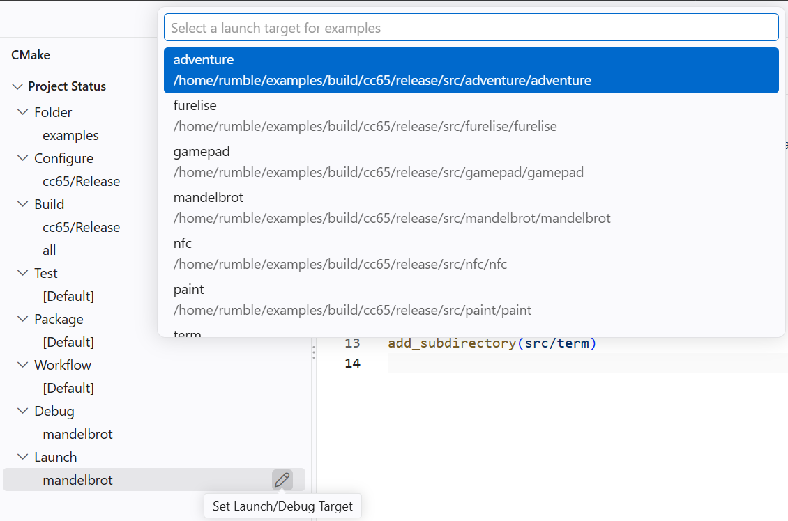
         showing the project's ROMs.

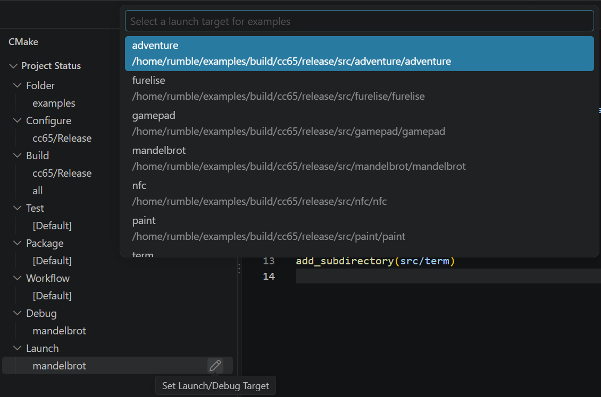
         showing the project's ROMs.

Web Players
===========

To build a web player for your program, add ``rp6502_web()``:

.. code-block:: cmake

  rp6502_web(hello)

The build writes ``web/hello.zip`` in the build directory. The zip is a
web player that holds the ROM, ``rp6502.js``, ``rp6502.wasm``, and
``index.html``. The build also unpacks the same files into
``web/hello/``. The "RP6502-WEB" launch configuration of `Running and
Debugging`_ opens a page with a link to each web player.

The web player has more :ref:`settings <web-cmake>`, such as its title
and its footer, and can use your own ``index.html``.

.. _sdk-testing:

Testing
=======

Unit tests are hard to run on the 6502. Memory is a constraint, and a full
test framework is a lot for a small machine. Most test libraries require
an int of more than 16 bits, and the 6502 is slow. Unit tests therefore
usually run on the host computer. For the ROM itself, the emulator gives
strong integration tests: an emulator script drives the machine and checks
the results, and a Python test drives the emulator for a test that
requires more logic.

To add a test, give ``rp6502_test()`` a test file. It has the form of
CMake's own ``add_test()``:

.. code-block:: cmake

  rp6502_test(NAME <name> COMMAND <file> [<arg>...])

A ``.py`` file is a Python test, and any other file is an emulator
script. Each argument after the file is an emulator option or a ROM, and
the words after ``--`` are the arguments for the ROM.

A Python test imports ``rp6502``, which is ``tools/rp6502.py``. Its
``rp6502.Emu`` runs the emulator of the test and sends it script
commands:

.. list-table::
   :widths: 30 70
   :header-rows: 1

   * - Name
     - Description
   * - ``Emu(*args)``
     - Starts the emulator with the arguments that ``rp6502_test()``
       passes to the Python test. ``Emu()`` adds the arguments passed to
       it: emulator options, a ROM, and after ``"--"``, arguments for the
       ROM. When the two sets give the same option other than
       ``--install``, both give a ROM, or both give arguments for the ROM,
       ``Emu()`` raises ``ScriptError``.
   * - ``cmd(line)``
     - Sends one script command, and returns the text after ``ok``, such
       as the bytes from ``dump``. A ``fail`` raises ``ScriptError``.
   * - ``status()``
     - Sends ``status`` and returns its fields as a ``dict``.
   * - ``sym``
     - The symbols and values of the ``.sym`` file of the ROM that the
       emulator starts, as a ``dict``. A lookup of a symbol with two
       values raises ``KeyError`` with ``is ambiguous``.
   * - ``close()``
     - Ends the script and waits for the emulator. An exit code other
       than 0 raises ``ScriptError``.
   * - ``ScriptError``
     - ``cmd()`` raises it when a command fails. Its message shows the
       command, why it failed, the status line, and what the program
       printed after the last match. Its ``status`` is the status line as a
       ``dict``, the same as ``status()`` returns.

Run the tests from the Testing view of the Side Bar, or with ``ctest``:

.. code-block:: text

  ctest --test-dir build/cc65/debug

Each test runs in its own directory, with its own save directory. With the
``cc65/Debug`` preset, a test named ``input`` runs in
``build/cc65/debug/test/input/``, and its save directory is
``build/cc65/debug/test/input/save/``.

To find programs that read uninitialized memory, the emulator fills RAM
and XRAM with random values. The values are different in each run, so a
test or a program that reads uninitialized memory shows its poor
behavior... eventually.

When a test fails, the emulator prints the reason, then a status line:

.. code-block:: text

  rp6502-emu: src/gamepad/tests/connect.txt:5: $0000+0 is $AC, expected $D0
  rp6502-emu: PC=$FFF3 A=$18 X=$FF Y=$00 SP=$EB P=$04 OP=$18 BUSY=$00 RESB=1 SEED=1924711803 MEMSEED=3733940630 ROM=FS:/home/user/my-project/build/cc65/debug/gamepad/gamepad.rp6502

A failed Python test shows the same lines in a ``ScriptError`` at the end
of a traceback.

If you suspect uninitialized memory, you can run the test again with the
same values in memory. ``MEMSEED`` is the seed that filled memory in the
failed run. Add ``--memseed`` and the ``MEMSEED`` value to the arguments
of the test. Then build the project and run the test again.

Putting it all together, these are typical tests in ``CMakeLists.txt``:

.. code-block:: cmake

  rp6502_test(NAME input COMMAND tests/input.txt
      $<TARGET_PROPERTY:hello,RP6502_ROM>)
  rp6502_test(NAME scores COMMAND tests/scores.py
      --memseed 123 $<TARGET_PROPERTY:hello,RP6502_ROM>)

CMake replaces ``$<TARGET_PROPERTY:hello,RP6502_ROM>`` with the path of
the ROM of ``hello``.

Launch Configurations
=====================

To change how F5 starts a ROM, edit the settings of the launch
configuration that you run. The settings are in ``.vscode/launch.json``
for RP6502-EMU, in ``.rp6502`` for RP6502-PICO, and in
``CMakeLists.txt`` for RP6502-WEB. In each one, the arguments for the ROM
are separate from the other settings, such as the options of the emulator
or the settings of the web player.

A ROM can start with arguments, which a C program receives as ``argc``
and ``argv`` of ``main()``. Unlike on other systems, you must set up the
program to receive them. To learn how, read :ref:`ARGV <api-argv>` on the
API page.

RP6502-EMU
----------

The "RP6502-EMU" launch configuration is in ``.vscode/launch.json``.
``args`` holds the arguments for the ROM. To pass :ref:`options
<emu-arguments>` to the emulator, add them to ``debugAdapterArgs`` after
the options that are already there. This launch configuration passes
``level2`` to the ROM and runs the 6502 at 1 MHz:

.. code-block:: json

  {
      "name": "RP6502-EMU",
      "type": "lldb-dap",
      "request": "launch",
      "debugAdapterExecutable": "${command:cmake.launchTargetDirectory}/rp6502-emu",
      "debugAdapterArgs": [
          "--dap",
          "--ini",
          "${workspaceFolder}/.rp6502",
          "--phi2",
          "1000"
      ],
      "windows": {
          "debugAdapterExecutable": "${command:cmake.launchTargetDirectory}/rp6502-emu.exe"
      },
      "program": "${command:cmake.launchTargetPath}.rp6502",
      "args": ["level2"],
      "stopOnEntry": false,
      "stopOnExit": true
  }

RP6502-PICO
-----------

``.rp6502`` in the project directory holds the settings of your
workstation, so git ignores it. The first run of the "RP6502-EMU" or
"RP6502-PICO" launch configuration creates it.

The file has several sections. The emulator writes most of them, with the
window layout of its debug overlay, so each project reopens with the
layout of its last session. The ``[RP6502][PICO]``
section is first. It holds the settings for running on your
RP6502-PICO, and it is the only section to edit by hand. The first run
of the "RP6502-PICO" launch configuration adds it:

.. code-block:: text

  [RP6502][PICO]
  device = /dev/ttyACM0
  key =
  workdir =
  args =
  term = True

.. list-table::
   :widths: 20 80
   :header-rows: 1

   * - Setting
     - Description
   * - ``device``
     - How to connect to your RP6502-PICO: a serial port, or a hostname
       or IP address for telnet. A new settings file fills in a hint of
       the form of a serial port. Replace it with the exact port or
       address. A hostname or IP address requires ``key``, and may end
       with ``:port``. The default port is 23.
   * - ``key``
     - Passkey for telnet. Leave it empty to use a serial port. See
       :ref:`Telnet Console <pico-telnet-console>`.
   * - ``workdir``
     - The directory to work in, from the root of the current drive. The
       launch configuration uploads the ROM to this directory and runs it
       from there. Leave it empty to work in the current directory of the
       RP6502-PICO.
   * - ``args``
     - The arguments for the ROM.
   * - ``term``
     - With ``True``, ``rp6502.py`` opens a terminal on the console when a
       ROM runs on an RP6502-PICO.

For telnet, set ``device`` and ``key``:

.. code-block:: text

  [RP6502][PICO]
  device = example.com:23
  key = secret
  workdir =
  args =
  term = True

RP6502-WEB
----------

The "RP6502-WEB" launch configuration opens the web players of the
build, so its settings are in ``rp6502_web()`` in ``CMakeLists.txt``.
``args`` in ``CONFIG`` holds the arguments for the ROM, and the other
options are :ref:`settings <web-cmake>` of the web player. This call
passes ``level2`` to the ROM and gives the web player a title:

.. code-block:: cmake

  rp6502_web(hello CONFIG [[
      title: 'Hello',
      args: ['level2'],
  ]])

Load Addresses and Linker Scripts
=================================

``rp6502_executable()`` packages the linker output of a target, the file
that the linker writes, into a ROM with the assets of the target. The
keywords of ``rp6502_executable()`` give the addresses of the program:

.. list-table::
   :widths: 20 80
   :header-rows: 1

   * - Keyword
     - Description
   * - ``DATA``
     - The address where the linker output loads. Without ``DATA``, the
       ROM does not hold the linker output.
   * - ``RESET``
     - The address where the 6502 starts. The ROM holds it in the reset
       vector at ``$FFFC-$FFFD``. ``rp6502_executable()`` requires
       ``RESET``.
   * - ``IRQ``
     - The address of the IRQ handler. The ROM holds it in the IRQ vector
       at ``$FFFE-$FFFF``. A call may leave out ``IRQ``.
   * - ``NMI``
     - The address of the NMI handler. The ROM holds it in the NMI vector
       at ``$FFFA-$FFFB``. A call may leave out ``NMI``.

Each keyword takes a number, such as ``0x200``, or ``file``. ``DATA``
and ``RESET`` also take ``default``:

- With ``file``, the build reads the address from the start of the
  linker output. Each keyword that is ``file`` takes the next 16-bit
  address, in the order ``DATA``, ``NMI``, ``RESET``, ``IRQ``. The linker
  script of llvm-mos writes the ``DATA`` address and then the ``RESET``
  address there, so ``file`` works for both. The linker script of cc65
  writes no addresses.
- ``default`` is ``0x200`` with cc65 and ``file`` with llvm-mos.

The linker script is the map of 6502 RAM, as ``xram.h`` is the map of
`XRAM <XRAM Memory Map_>`_. Most projects keep the linker script of the
compiler. To change the map, start from a copy of the linker script of
the compiler. Pass the copy to the linker with ``target_link_options()``.
Add the copy to ``LINK_DEPENDS``, so that the build relinks the program
when the copy changes.

For cc65, copy ``cfg/rp6502.cfg`` from the directory of cc65, such as
``~/.rp6502/cc65``, into the project. To learn its format, read the `ld65
documentation <https://cc65.github.io/doc/ld65.html>`__.

.. code-block:: cmake

  target_link_options(hello PRIVATE -C ${CMAKE_SOURCE_DIR}/src/hello.cfg)
  set_target_properties(hello PROPERTIES
      LINK_DEPENDS ${CMAKE_SOURCE_DIR}/src/hello.cfg)

For llvm-mos, copy ``mos-platform/rp6502/lib/link.ld`` from the
directory of llvm-mos, such as ``~/.rp6502/llvm-mos``, into the project.
To learn its format, read the llvm-mos wiki page `Linker Script
<https://llvm-mos.org/wiki/Linker_Script>`__.

.. code-block:: cmake

  target_link_options(hello PRIVATE -T ${CMAKE_SOURCE_DIR}/src/hello.ld)
  set_target_properties(hello PROPERTIES
      LINK_DEPENDS ${CMAKE_SOURCE_DIR}/src/hello.ld)

Multiple Linker Outputs
=======================

A cc65 program can load at more than one address, with one linker output
for each address. In the linker configuration, each memory area with a
``file`` of its own writes a separate linker output. ``%O`` is the file
name that CMake passes to the linker, so ``"%O.1000"`` names a file beside
the linker output of the target. The linker of llvm-mos writes only one
linker output.

Microsoft BASIC loads at three addresses: the ``CHRGET`` routine at
``$00E8`` in zero page, the init code at ``$1000``, and the interpreter at
``$C000``. Its linker configuration gives each one its own file:

.. code-block:: text

  MEMORY {
      ZP:       start = $0000, size = $00E7, file = "";
      CHRGETZP: start = $00E8, size = $0018, file = "%O.00E8";
      INITROM:  start = $1000, size = $8000, file = "%O.1000";
      BASROM:   start = $C000, size = $3DDE, file = "%O.C000";
      # areas with file = "" write nothing; trimmed here
      TOUCH:    start = $0000, size = $0000, file = %O;
  }

``TOUCH`` is an empty memory area whose file is ``%O``. The linker writes
it as an empty file, and CMake treats that file as the linker output.

Add each file that the link writes with ``rp6502_byproduct()``. It adds
the file as an asset, as ``rp6502_asset()`` does, but packages it after
the link. ``rp6502_asset()`` cannot take a file that the link writes. Each
file that ``rp6502_asset()`` takes is an input of the link, so that a
change to the file links the program again and rewrites the ROM.

``rp6502_byproduct()`` takes the same addresses as ``rp6502_asset()``. A
relative path of ``rp6502_asset()`` starts in the project directory. A
relative path of ``rp6502_byproduct()`` starts in the build directory, in
the directory of the linker output:

.. code-block:: cmake

  rp6502_byproduct(<target> <address> <file>)

This CMake code adds the three files as memory chunks at their addresses,
and packages them:

.. code-block:: cmake

  rp6502_asset(basic help src/help.txt)
  rp6502_byproduct(basic RAM(0x00E8) basic.00E8)
  rp6502_byproduct(basic RAM(0x1000) basic.1000)
  rp6502_byproduct(basic RAM(0xC000) basic.C000)
  rp6502_executable(basic RESET 0x1000)

``rp6502_executable()`` has no ``DATA`` here, because the linker output
is the empty ``TOUCH`` file.

.. _sdk-updating-tools:

Updating the Tools
==================

``tools/`` holds the tools that build and test your program. They change
only when you update them. To update them, run the "RP6502: update
tools" task (Terminal > Run Task), or run this command in the project
directory:

.. code-block:: text

  cmake -P tools/rp6502.cmake

The update does these steps:

#. It downloads the latest scripts from the `tools directory
   <https://github.com/picocomputer/rp6502/tree/main/tools>`__ of the
   ``main`` branch of picocomputer/rp6502. Each new script replaces the
   old one, so the update discards local changes to the scripts.
#. It updates the settings in ``.vscode/``, ``.gitignore``, and
   ``CMakeLists.txt`` when they are out of date.
#. It downloads the latest release of the emulator, the web player, and
   BASIC, for each one that ``tools/`` already has.

After the update, check its output for errors. An error leaves only part
of the update in place, so resolve the error and run the update again.
Then test that your project still works, and commit the changes.

When CMake configures your project, it downloads each tool that the
project uses and that ``tools/`` lacks. You do not download any tool
yourself.

The scripts, ``rp6502.cmake``, ``rp6502.py``, ``cc65-toolchain.cmake``,
and ``cc65-config.cmake``, come from the ``main`` branch of
picocomputer/rp6502. They have no versions, and they can change between
releases. Commit them with the project, so that every Git clone builds
with the same scripts.

The emulator, the web player, and BASIC come from the releases of
`picocomputer/rp6502 <https://github.com/picocomputer/rp6502/releases>`__
and `picocomputer/msbasic
<https://github.com/picocomputer/msbasic/releases>`__. In ``tools/``,
each of them keeps the file name of its release:

.. code-block:: text

  rp6502-<version>-windows.zip
  rp6502-<version>-macos.zip
  rp6502-<version>-linux-x86_64.tar.gz
  rp6502-<version>-linux-aarch64.tar.gz
  rp6502-<version>-web.zip
  msbasic-<version>.zip

You do not need to commit these files to your repository. To keep your
project on a specific version, see `Selecting Versions`_.

WSL uses the emulator for Windows. When a release has no emulator for
your system, ``tools/`` holds ``rp6502-<version>-<system>.unsupported``
in its place.

.. _sdk-selecting-versions:

Selecting Versions
------------------

Each target and test uses the newest version in ``tools/``. To use
another version, select it in ``CMakeLists.txt``. A variable selects the
version for every target and test in its ``CMakeLists.txt``:

.. code-block:: cmake

  set(RP6502_EMU_VERSION 0.40)
  set(RP6502_WEB_VERSION 0.40)
  set(RP6502_BASIC_VERSION 0.1)

A property selects the version for one target or one test:

.. code-block:: cmake

  set_target_properties(hello PROPERTIES RP6502_EMU_VERSION 0.39)
  set_target_properties(hello PROPERTIES RP6502_WEB_VERSION 0.39)
  set_target_properties(trek PROPERTIES RP6502_BASIC_VERSION 0.1)
  set_tests_properties(input PROPERTIES RP6502_EMU_VERSION 0.39)

When CMake configures the project, it downloads each version that the
project selects and that ``tools/`` lacks. ``tools/`` can hold several
versions of each tool.

Local Files
-----------

To use your own build of the emulator, the web player, or BASIC, set
``RP6502_EMU``, ``RP6502_WEB``, or ``RP6502_BASIC`` to the path of its
file: an emulator, the zip of a web player, or a ``basic.rp6502``. These
settings work like the version settings, and a file overrides any
version.

This example uses a custom BASIC. Commit its file with the project, in a
place that Git does not ignore. In ``tools/``, Git ignores only the files
whose names start with ``rp6502-`` or ``msbasic-``, so you can put it
there as ``mybasic.rp6502``. Then select the file in ``CMakeLists.txt``:

.. code-block:: cmake

  set_target_properties(trek PROPERTIES RP6502_BASIC tools/mybasic.rp6502)

To test a file for a short time, set it on the command line instead:

.. code-block:: text

  cmake --preset cc65/Debug -DRP6502_EMU=/home/user/rp6502/build/sokol/rp6502-emu

The setting stays until you remove it, or until you delete the
``build/`` directory. This command removes it:

.. code-block:: text

  cmake --preset cc65/Debug -U RP6502_EMU

Another option to keep a setting for your system only is
``CMakeUserPresets.json``, which git ignores.

Command Line
============

This section is for advanced users who work with another editor, with a
6502 program from another toolchain, or for continuous integration. The
build and the automatic download of the tools are part of CMake, so they
work wherever CMake runs. CMake downloads the tools that ``tools/`` lacks,
so the first configure of a fresh Git clone requires a network
connection.

The examples below get you started. For everything else, read the `CMake
documentation <https://cmake.org/cmake/help/latest/>`__ and the help of
``rp6502.py``.

Building
--------

The project builds with its CMake presets. These commands list the
presets, then configure and build ``cc65/Debug``:

.. code-block:: text

  cmake --list-presets
  cmake --preset cc65/Debug
  cmake --build --preset cc65/Debug

The build writes the ROM to ``build/cc65/debug/hello/hello.rp6502``.

Running on an RP6502-PICO
-------------------------

``rp6502.py run`` runs a ROM on an RP6502-PICO from the command line. It
uploads the ROM, loads it with the monitor, and connects your terminal to
the console of the RP6502-PICO, so you can interact with the program.
Give the serial port with ``-d``, or for telnet, the hostname or IP
address with ``-d`` and the passkey with ``-k``:

.. code-block:: text

  python3 tools/rp6502.py run -d /dev/ttyUSB0 build/cc65/debug/hello/hello.rp6502
  python3 tools/rp6502.py run -d 192.168.1.20 -k secret build/cc65/debug/hello/hello.rp6502

``run`` passes the words after the path of the ROM to the ROM as its
arguments. ``python3 tools/rp6502.py --help`` lists the subcommands. To
list the options of a subcommand, put ``--help`` after it, as in
``python3 tools/rp6502.py run --help``. ``rp6502.py`` has these
subcommands:

.. list-table::
   :widths: 20 80
   :header-rows: 1

   * - Subcommand
     - Description
   * - ``run``
     - Upload a ROM to the RP6502-PICO, load it, and open a terminal.
   * - ``upload``
     - Upload files to the RP6502-PICO.
   * - ``term``
     - Open a terminal on the console.
   * - ``basic``
     - Send a BASIC program to the BASIC installed on the RP6502-PICO, and
       run it.
   * - ``create``
     - Package a file into a ROM, and merge ROMs into it. See `Packaging
       a ROM Manually`_.
   * - ``sym``
     - Write the ``.sym`` file of a linked program, which holds its
       `program symbols <Program Symbols_>`_.

``run``, ``upload``, ``term``, and ``basic`` work through the monitor, so
they send a break first. The break stops any ROM that runs on the
RP6502-PICO and returns to the monitor.

Running in the Emulator
-----------------------

The emulator of a target is ``rp6502-emu`` in the directory of the
target, or ``rp6502-emu.exe`` on Windows. These examples run a ROM with
some of the emulator's :ref:`options <emu-arguments>`:

.. code-block:: text

  build/cc65/debug/hello/rp6502-emu --debug build/cc65/debug/hello/hello.rp6502
  build/cc65/debug/assemble/rp6502-emu --headless --phi2 0 build/cc65/debug/assemble/assemble.rp6502
  build/basic/trek/rp6502-emu --script tests/play.txt build/basic/trek/trek.rp6502

With ``--debug``, the emulator draws the :ref:`debug overlay
<emu-overlay>` over its window.

With ``--headless``, the emulator opens no window. The ROM's console is
the host's stdin and stdout. The ROM's exit code becomes the exit code of
the emulator, so a ROM can run as a step in a shell script or a test.
``--phi2 0`` removes the speed limit.

With ``--script``, the :ref:`emulator script <emu-scripting>`
``tests/play.txt`` drives the machine and checks the results, as it does
in a `test <Testing_>`_.

Packaging a ROM Manually
------------------------

When an assembler or compiler that CMake does not run writes the 6502
program, package the ROM with ``rp6502.py create``. Each run of
``create`` writes one ROM, and can merge other ROMs into it. A ROM does
not have to hold a program. It can hold any memory chunks and named
assets, such as an image for XRAM or the help text.

ROMs therefore work like object files. Package each part of the program
in its own ROM, then merge them all in a last step, as a linker joins
object files. ``rp6502_asset()`` and ``rp6502_executable()`` build a ROM
this way. Any ROM can hold any part, but the final ROM must hold the
reset vector to run.

``create`` uses these options:

- ``-a``: the address to load the file at, or an asset name. The address
  can also be ``RAM(<x>)`` or ``XRAM(<x>)``, where ``<x>`` is a number
  or a symbol from the ``.sym`` file that ``--sym`` gives.
- ``-r``: the reset vector. ``-i`` and ``-n`` set the IRQ and NMI
  vectors.
- ``-o``: the ROM file to write.

With ``-a``, the first file is the file to package, and every file after
it is a ROM to merge. Without ``-a``, every file is a ROM to merge.

This example packages the help text, a data file, and an image in ROMs
of their own. The last step packages the output file of an assembler,
which loads at ``$0400``, and merges the other ROMs into it.

.. code-block:: text

  # The help text, as a named asset.
  python3 tools/rp6502.py create -a help -o help.rp6502 plvm.help

  # A data file the program opens as ROM:level1.
  python3 tools/rp6502.py create -a level1 -o level1.rp6502 level1.dat

  # An image that the RIA loads into XRAM before the 6502 starts.
  python3 tools/rp6502.py create -a 0x10000 -o splash.rp6502 splash.bin

  # The program at $0400 with the reset vector, merged with the rest.
  python3 tools/rp6502.py create -a 0x0400 -r 0x0400 -o plvm.rp6502 \
      plvm.bin help.rp6502 level1.rp6502 splash.rp6502

The result is ``plvm.rp6502``. It holds memory chunks for the program at
``$0400``, the reset vector at ``$FFFC``, and the image at ``$10000``. It
also holds two named assets, ``help`` and ``level1``.

.. _sdk-sym-file:

The .sym File
=============

The build writes ``hello.sym`` beside ``hello.rp6502``. The file has one
line for each symbol and value of the program: each ``#define`` with a
whole-number value that is in effect in a ``.c`` source file, including
the ``#define`` lines of its headers, and each symbol of the linker. A
line is the symbol, one space, and the value. A value from 0 to 0xFFFF is hex,
with ``0x`` and four digits. Any other value is decimal:

.. code-block:: text

  INT8_MIN -128
  XRAM_KEYBOARD 0x0000
  XRAM_LOGO 0x0020

The build sorts the lines by symbol, then by value. A symbol with two
different values, such as a label that cc65 generates, like ``L0001``, has
two lines. A lookup of that symbol fails because it is ambiguous. cc65
puts ``_`` before each C symbol. The build writes each such symbol with
and without the ``_``, so a C global ``x`` is in the file as ``x`` and as
``_x``. With cc65, a ``static`` variable of a function is in the file
only as a label that cc65 generates, such as ``M0001``. With llvm-mos, it
is in the file as the function and the variable, such as
``main.counter``.

The symbols in this file work in ``RAM()`` and ``XRAM()`` addresses, in
``rp6502_align()``, in emulator scripts, and in Python tests. `Program
Symbols`_ shows each use.

.. _sdk-rom-file-format:

ROM File Format
===============

A ROM file is a shebang line, then a group of memory chunks, then any
number of named assets. A ROM that holds only named assets, such as an
input for a merge, has no group. Header lines are text and end with
``\n`` or ``\r\n``. The tools write ``\r\n``. Spaces separate the
fields of a header line. A number may be decimal (255), C-style hex
(0xFF), or MOS-style hex ($FF). Each CRC is CRC-32 as zlib and PNG
compute it.

This is the ``hello.rp6502`` of a new project, built with the cc65/Debug
preset. Each ``...`` line stands for binary data. The text at the right
of each line is a note, not part of the file:

.. code-block:: text

  #!RP6502                         shebang
  #>$000002FA $DEA2E883            memory chunks, 0x2FA bytes follow
  $0200 $2CC $C261269A             chunk: 0x2CC bytes at $0200
  ...                              0x2CC bytes of program
  $FFFC $002 $AFD773D3             chunk: 2 bytes at $FFFC
  ...                              2 bytes, the reset vector
  #>$0000006E $E047820E help       named asset: 0x6E bytes
  ...                              0x6E bytes of help text

**Shebang.** The shebang is the first line of every ROM file. The tools
write:

.. code-block:: text

  #!RP6502

Any first line that starts with ``#!`` and contains ``rp6502``, without
regard to case, is valid. The first line can therefore give the command
that runs the ROM. A ROM file marked executable then runs from a shell
when that command is on the PATH:

.. code-block:: text

  #!/usr/bin/env rp6502-emu

**Memory chunks.** The line after the shebang starts the group of memory
chunks, which the RIA loads into 6502 RAM or XRAM before the 6502 starts:

.. code-block:: text

  #>len crc

``len`` is the number of bytes that follow in the group. It counts the
header line of each memory chunk as well as its binary data. ``crc`` is
the CRC-32 of those bytes. Each memory chunk is a header line followed by
its binary data:

.. code-block:: text

  addr len crc

.. list-table::
   :widths: 1 20
   :header-rows: 1

   * - Field
     - Description
   * - ``addr``
     - Destination address in 6502 RAM (``$0000-$FEFF``), the 6502
       vectors (``$FFFA-$FFFF``), or XRAM (``$10000-$1FFFF``). The RIA
       ignores data for ``$FF00-$FFF9``. A ROM runs only if it sets the
       reset vector at ``$FFFC-$FFFD``.
   * - ``len``
     - Number of bytes of binary data that follow this line, from 1 to
       1024. A memory chunk must not cross a 64 KB boundary.
   * - ``crc``
     - CRC-32 of the binary data.

**Named assets.** A named asset is a file that the program opens by name
while the ROM runs. Named assets follow the group, one after another, to
the end of the file. Each named asset is a header line followed by its
binary data. The header of a named asset has a name, and the header of
the group has none:

.. code-block:: text

  #>len crc name

.. list-table::
   :widths: 1 20
   :header-rows: 1

   * - Field
     - Description
   * - ``len``
     - Number of bytes of binary data that follow this line.
   * - ``crc``
     - CRC-32 of the binary data.
   * - ``name``
     - The name of the asset, to the end of the line. A program opens the
       asset as ``ROM:`` and the name. The RIA compares names without
       regard to case.

The format sets no limit on the number of named assets. When a program
opens an asset, the RIA reads each asset header in file order and skips
its binary data until the name matches. In a ROM with many assets, the
last assets therefore take longer to open.

.. _sdk-updating:

Upgrading an Older Project
==========================

Because :ref:`cc65 does not support volatile <ria-volatile>`, the
macros of the old ``rp6502.h`` did not always work. The SDK removed them,
and now uses C library functions to access the RIA and XRAM. An older
project needs changes to build with the current compilers and tools.
Upgrade it in two steps.

First, make the project build and run again:

#. Install the current compilers with the commands in `Installing the
   Prerequisites`_.
#. If the project has ``tools/CMakeLists.txt``, it comes from an older
   template that sets its compiler at the top of ``CMakeLists.txt``.
   Change its build to the one of the `current template
   <https://github.com/picocomputer/rp6502-sdk>`__:

   a. Copy ``tools/rp6502.cmake`` from the template over the one in the
      project. The first configure fetches the rest of the tools.
   b. Replace everything above ``project()`` in ``CMakeLists.txt`` with
      these lines:

      .. code-block:: cmake

        cmake_minimum_required(VERSION 3.28)
        include(${CMAKE_CURRENT_LIST_DIR}/tools/rp6502.cmake)

   c. Delete ``tools/CMakeLists.txt`` and the ``add_subdirectory(tools)``
      line.
   d. Copy ``CMakePresets.json`` from the template.

#. Update the tools as in `Updating the Tools`_.
#. Add ``xram.h`` to the project, from ``src/`` of the template or as an
   empty file. For an assembly project, add ``xram.inc``. The structures
   and macros that the table copies from the datasheets go in this file.
#. In a C project, add ``rp6502-compat.h`` from the end of this section.
   Include ``"rp6502-compat.h"`` in place of ``<rp6502.h>``. The header
   defines most of the old names, so the code that uses them builds
   unchanged.
#. Build and test the project. For each error, find the old name,
   option, or command in the table below. Change it to its replacement.
   Change only what fails. ``rp6502-compat.h`` defines most of the old
   names, and the second step replaces those.

Then stop using the compat header:

#. Replace each name that ``rp6502-compat.h`` defines with its
   replacement from the table.
#. Lay out XRAM in ``xram_layout_t``, so that ``xram.h`` holds the
   `XRAM memory map <XRAM Memory Map_>`_.
#. Include ``<rp6502.h>`` in place of ``"rp6502-compat.h"``. Remove
   ``rp6502-compat.h`` from the project.
#. Build and test the project.

This table lists the changes that break an older project:

.. list-table::
   :widths: 40 60
   :header-rows: 1

   * - Old
     - New
   * - ``xram0_struct_set(addr, type, member, val)``,
       ``xram1_struct_set``
     - ``xram0_poke8`` or ``xram0_poke16`` at
       ``addr + offsetof(type, member)``, and the ``xram1_`` versions. A
       4-byte member requires two ``xram0_poke16`` calls.
   * - ``vga_mode1_config_t``, ``vga_mode2_config_t``,
       ``vga_mode3_config_t``
     - ``mode1_config_t``, ``mode2_config_t``, and ``mode3_config_t``
       from :ref:`vga-mode-1`, :ref:`vga-mode-2`, and :ref:`vga-mode-3`,
       with the same layout.
   * - ``vga_mode4_sprite_t``, ``vga_mode4_asprite_t``,
       ``vga_mode5_sprite_t``
     - ``mode4_sprite_t`` and ``mode4_asprite_t`` from :ref:`vga-mode-4`,
       and ``mode5_sprite_t`` from :ref:`vga-mode-5`, with the same
       layout.
   * - ``xreg_ria_keyboard``, ``xreg_ria_mouse``, ``xreg_ria_gamepad``,
       ``xreg_ria_tablet``
     - Copy the same macros from the :doc:`ria` datasheet into
       ``xram.h``.
   * - ``xreg_vga_canvas``
     - Copy the same macro from :ref:`vga-key-registers` into
       ``xram.h``.
   * - ``xreg_vga_mode(n, ...)``
     - One macro per mode from the :doc:`vga` datasheet,
       ``xreg_vga_mode0`` to ``xreg_vga_mode5``. ``xreg_vga_mode(3, ...)``
       becomes ``xreg_vga_mode3(...)``.
   * - ``phi2()``
     - ``ria_attr_get(RIA_ATTR_PHI2_KHZ)``
   * - ``code_page(cp)``, ``codepage(cp)``
     - ``ria_attr_set(cp, RIA_ATTR_CODE_PAGE)`` when ``cp`` is not 0, then
       ``ria_attr_get(RIA_ATTR_CODE_PAGE)`` for the code page in use.
   * - ``lrand()``
     - ``ria_attr_get(RIA_ATTR_LRAND)``
   * - ``ria_push_long``, ``ria_push_int``, ``ria_push_char``,
       ``ria_pop_long``, ``ria_pop_int``, ``ria_pop_char``,
       ``ria_set_axsreg``, ``ria_set_ax``, ``ria_set_a``,
       ``ria_call_int``, ``ria_call_long``, ``ria_call_int_errno``,
       ``ria_call_long_errno``
     - None. The C function of each API call is in :doc:`api`. The C
       library passes the ARGV arguments to ``main()`` as
       ``argc`` and ``argv`` when the program defines ``__argv_mem()``.
       See :ref:`ARGV <api-argv>`.
   * - ``RIA_READY_TX_BIT``, ``RIA_READY_RX_BIT``, ``RIA_BUSY_BIT``
     - None.
   * - ``RIA_OP_ZXSTACK``
     - ``RIA_OP_DROP_XSTACK``, or ``ria_drop()`` in C.
   * - ``RIA_OP_UNLINK``
     - ``RIA_OP_REMOVE``.
   * - ``f_chdrive()``, ``RIA_OP_CHDRIVE``
     - ``chdir()``, or ``RIA_OP_CHDIR``. A drive name alone, such as
       ``MSC1:``, changes the drive.
   * - ``f_getcwd()``
     - ``getcwd()``. It returns a pointer to the path, not its length.
   * - ``RIA_OP_PHI2``, ``RIA_OP_CODE_PAGE``, ``RIA_OP_CODEPAGE``,
       ``RIA_OP_LRAND``, ``RIA_OP_ERRNO_OPT``
     - ``RIA_OP_ATTR_GET`` or ``RIA_OP_ATTR_SET`` with
       ``RIA_ATTR_PHI2_KHZ``, ``RIA_ATTR_CODE_PAGE``, ``RIA_ATTR_LRAND``,
       or ``RIA_ATTR_ERRNO_OPT``. In C, ``ria_attr_get()`` and
       ``ria_attr_set()``.
   * - ``RIA_OP_STDIN_OPT``, ``stdin_opt(ctrl_bits, str_length)``
     - ``ria_attr_set(str_length, RIA_ATTR_RLN_LENGTH)``. ``ctrl_bits``
       has no replacement.
   * - ``RIA_OP_CLOCK``
     - ``RIA_ATTR_CLK_RUN_MS``, ``RIA_ATTR_CLK_RUN_CS``,
       ``RIA_ATTR_CLK_RUN_DS``, or ``RIA_ATTR_CLK_RUN_S``. In C,
       ``clock()``.
   * - ``RIA_OP_CLOCK_GETTIME``, ``RIA_OP_CLOCK_SETTIME``
     - ``RIA_OP_TIME_GET`` and ``RIA_OP_TIME_SET``. In C, ``time()`` and
       ``time_set()``.
   * - ``RIA_OP_CLOCK_GETRES``, ``RIA_OP_CLOCK_GETTIMEZONE``,
       ``ria_tzset(time)``
     - None. The RIA computes local time.
   * - ``__oserror``, ``_oserror``, ``FRESULT``, ``FR_*``
     - ``errno`` with the names of ``errno.h``. Nothing sets
       ``__oserror``.
   * - ``RIA.step0``, ``RIA.step1`` as ``unsigned char``
     - The same members, as ``signed char``.
   * - An assembly macro, or a ca65 label, named ``xreg``
     - ``xreg`` is now a macro in ``rp6502.inc``. Rename or remove the
       one in the project.
   * - ``rp6502_byproducts(<target> <file>...)``, and an
       ``rp6502_asset()`` call for each file
     - ``rp6502_byproduct(<target> <address> <file>)`` for each file. A
       relative ``<file>`` starts in the directory of the linker output.
       An old call stops configure with ``Unknown CMake command``. See
       `Multiple Linker Outputs`_.
   * - Emulator option ``--seed <n>``
     - ``--memseed <n>`` for the fill of RAM and XRAM, and the script
       command ``seed <n>`` for the random numbers of the program.
   * - Emulator option ``--fill <byte>``, ``--fill random``
     - ``--memfill <byte>``. Without an option, the fill is random.
   * - Script command ``expect-exit <code> [frames]``
     - ``wait exit [frames]``, then ``expect exit <code>``.
   * - Script commands ``wait "text"``, ``expect "text"``, and
       ``expect-not "text"``, which read the console
     - The same commands read stdout. For text that only the console
       carries, add ``console``, as in ``wait console "text"``.
   * - Script command ``seed`` with no argument, which printed the seed
     - ``status``, which prints ``SEED=``.
   * - Script command ``type "...\n"`` for Enter
     - ``type "...\r"``. ``\n`` sends LF. The line editor ends a line on
       CR or on LF.
   * - With ``reply on``, a ``fail`` line
     - A ``fail`` line, then a status line.
   * - ``rp6502.py emu``, ``rp6502.py execute``, ``rp6502.py web``
     - ``emu``: the emulator of the target, such as
       ``build/cc65/debug/hello/rp6502-emu``. ``execute``:
       ``rp6502-emu --headless`` or ``rp6502-emu --script``. ``web``:
       ``rp6502_web()`` and the "RP6502-WEB" launch configuration.
   * - ``tools/rp6502-emu``, ``tools/rp6502-emu.exe``
     - The emulator of the target. Configure deletes the old files.
   * - ``rp6502_web(... EMULATOR <spec>)``, ``RP6502_WEB_EMULATOR``,
       ``RP6502_EMU_RELEASE``
     - ``RP6502_WEB_VERSION`` or ``RP6502_WEB``, and
       ``RP6502_EMU_VERSION`` or ``RP6502_EMU``. See `Selecting
       Versions`_. ``EMULATOR`` stops configure. The two variables have
       no effect.
   * - ``rp6502_executable(... START <addr>)``
     - ``rp6502_executable(... DATA <addr>)``. ``DATA default RESET
       default`` works with both compilers.
   * - ``rp6502_map(<target> <header> <regex> [<exclude>])``
     - ``rp6502_align(<target> "<regex>")``, or with ``<exclude>``,
       ``rp6502_align(<target> "(?!(?:<exclude>)$)(?:<regex>)")``. The
       symbols come from the ``.c`` source files, not from ``<header>``.
   * - The ROM in the build directory, such as
       ``build/cc65/debug/hello.rp6502``
     - The ROM in the directory of its target, such as
       ``build/cc65/debug/hello/hello.rp6502``.
   * - ``<name>.bin.rp6502`` ROMs in a call to ``rp6502_executable()``
     - Remove them. ``rp6502_asset()`` adds each asset.
   * - ``rp6502_asset(<name> <addr> <in> <out>)``
     - ``rp6502_asset(<target> <address> <file>)``
   * - A ``.hlp`` help file
     - ``rp6502_asset(<target> help <text file>)``. ``create`` refuses a
       help file in the older ROM format.

This is ``rp6502-compat.h``:

.. code-block:: C
  :caption: rp6502-compat.h

  #ifndef RP6502_COMPAT_H
  #define RP6502_COMPAT_H

  #include <rp6502.h>
  #include <stddef.h>

  #define RIA_READY_TX_BIT 0x80
  #define RIA_READY_RX_BIT 0x40
  #define RIA_BUSY_BIT 0x80
  #define RIA_OP_ZXSTACK RIA_OP_DROP_XSTACK
  #define RIA_OP_UNLINK RIA_OP_REMOVE
  #define RIA_OP_CHDRIVE RIA_OP_CHDIR

  #define phi2() ((int)ria_attr_get(RIA_ATTR_PHI2_KHZ))
  #define code_page(cp)                                                    \
      ((cp) ? (void)ria_attr_set((cp), RIA_ATTR_CODE_PAGE) : (void)0,      \
       (int)ria_attr_get(RIA_ATTR_CODE_PAGE))
  #define lrand() ria_attr_get(RIA_ATTR_LRAND)

  #define xreg_ria_keyboard(...) xreg(0x0, 0x0, 0x00, __VA_ARGS__)
  #define xreg_ria_mouse(...) xreg(0x0, 0x0, 0x01, __VA_ARGS__)
  #define xreg_ria_gamepad(...) xreg(0x0, 0x0, 0x02, __VA_ARGS__)
  #define xreg_ria_tablet(...) xreg(0x0, 0x0, 0x03, __VA_ARGS__)
  #define xreg_vga_canvas(...) xreg(0x1, 0x0, 0x00, __VA_ARGS__)
  #define xreg_vga_mode(...) xreg(0x1, 0x0, 0x01, __VA_ARGS__)

  /* Bit tests, not ==, avoid a cc65 warning about constant comparisons.
     The casts avoid conversion warnings from the unused branches. */
  #define xram_struct_set_(n, a, size, v)                                  \
      ((size) & 1 ? xram##n##_poke8(a, (unsigned char)(v))                 \
       : (size) & 2 ? xram##n##_poke16(a, (unsigned)(v))                  \
       : (xram##n##_poke16(a, (unsigned)(v)),                              \
          xram##n##_poke16((a) + 2, (unsigned)((unsigned long)(v) >> 16))))
  #define xram0_struct_set(addr, type, member, val)                        \
      xram_struct_set_(0, (unsigned)(addr) + offsetof(type, member),       \
                       sizeof(((type *)0)->member), val)
  #define xram1_struct_set(addr, type, member, val)                        \
      xram_struct_set_(1, (unsigned)(addr) + offsetof(type, member),       \
                       sizeof(((type *)0)->member), val)

  typedef struct {
      unsigned char x_wrap, y_wrap;
      int x_pos_px, y_pos_px, width_chars, height_chars;
      unsigned xram_data_ptr, xram_palette_ptr, xram_font_ptr;
  } vga_mode1_config_t;

  typedef struct {
      unsigned char x_wrap, y_wrap;
      int x_pos_px, y_pos_px, width_tiles, height_tiles;
      unsigned xram_data_ptr, xram_palette_ptr, xram_tile_ptr;
  } vga_mode2_config_t;

  typedef struct {
      unsigned char x_wrap, y_wrap;
      int x_pos_px, y_pos_px, width_px, height_px;
      unsigned xram_data_ptr, xram_palette_ptr;
  } vga_mode3_config_t;

  typedef struct {
      int x_pos_px, y_pos_px;
      unsigned xram_sprite_ptr;
      unsigned char log_size, has_opacity_metadata;
  } vga_mode4_sprite_t;

  typedef struct {
      int transform[6];
      int x_pos_px, y_pos_px;
      unsigned xram_sprite_ptr;
      unsigned char log_size, has_opacity_metadata;
  } vga_mode4_asprite_t;

  typedef struct {
      int x_pos_px, y_pos_px;
      unsigned xram_sprite_ptr, palette_ptr;
  } vga_mode5_sprite_t;

  #endif /* RP6502_COMPAT_H */
