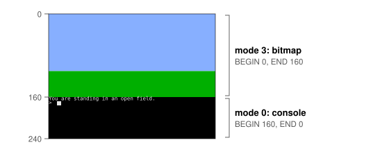
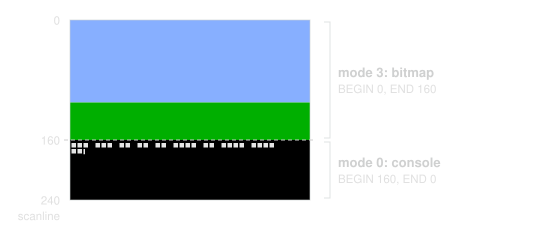
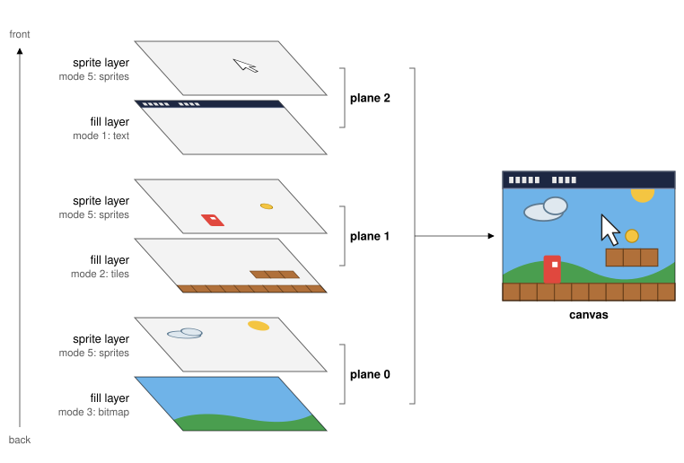
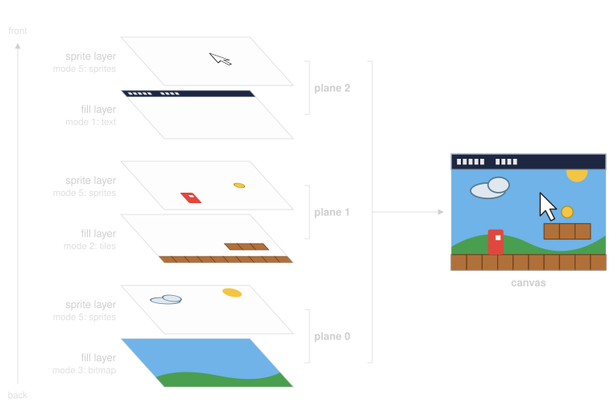
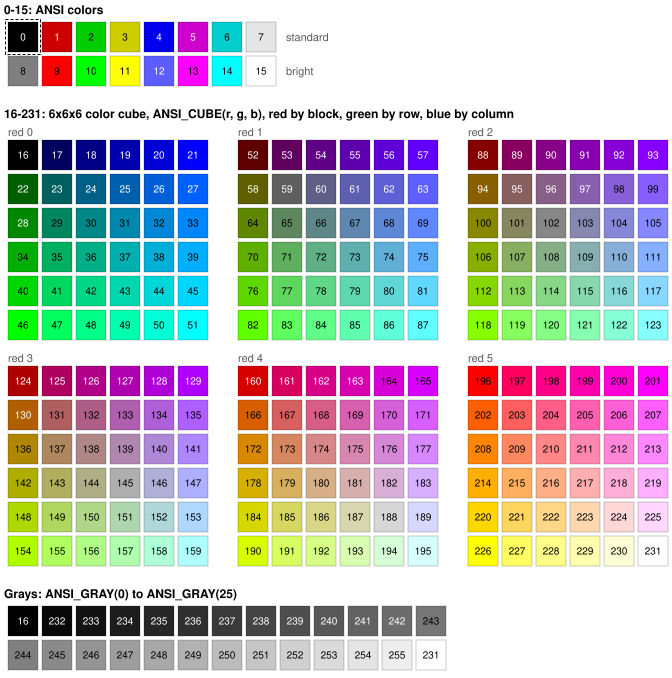
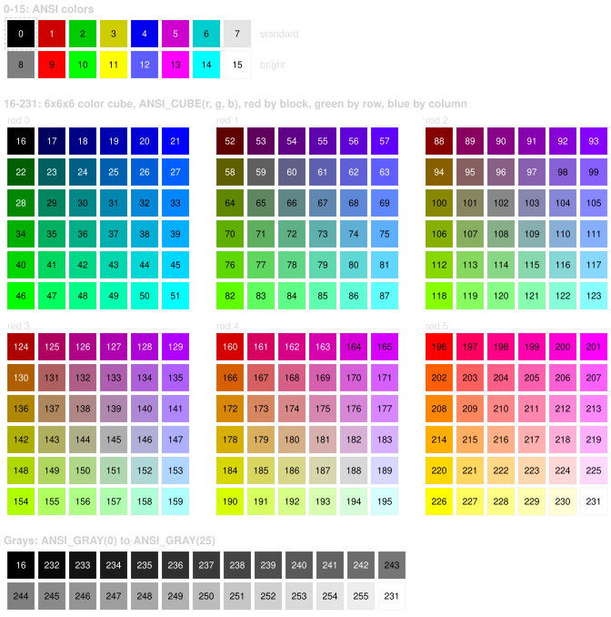

==================================
VGA
==================================

Video Graphics Array

Introduction
============

The RP6502 Video Graphics Array (VGA) is virtual video hardware modeled
on the home computers and arcades of the 8-bit and early-16-bit era. A
program sets it up with a few register writes and puts the graphics in
XRAM. From then on, the VGA system draws the video canvas on its own
while the 6502 keeps running the program.

It has the parts that the games of that era were built from. Text in
cells, tile maps, and bitmaps all scroll to the pixel. Sprites in 1-,
2-, 4-, or 8-bit color can each have their own palette, and sprites in
16-bit color can rotate and scale. Three planes stack all of these from
back to front, with transparency, so a status bar can sit over a
scrolling playfield. A plane can also switch from a bitmap to text
partway down the screen, without a scanline interrupt.

Getting Started
===============

Your program draws on the canvas, a grid of pixels such as 320x240. The
VGA system has six rendering modes:

.. list-table::
   :widths: 20 80
   :header-rows: 1

   * - Mode
     - Draws
   * - :ref:`Mode 0 <vga-mode-0>`
     - The console, with the text that your program prints.
   * - :ref:`Mode 1 <vga-mode-1>`
     - Colored text in cells, for menus and status bars.
   * - :ref:`Mode 2 <vga-mode-2>`
     - A tile map, for the playfield of a game.
   * - :ref:`Mode 3 <vga-mode-3>`
     - A bitmap, in which every pixel can be its own color.
   * - :ref:`Mode 4 <vga-mode-4>`
     - Sprites in 16-bit color, which can rotate and scale.
   * - :ref:`Mode 5 <vga-mode-5>`
     - Sprites in 1-, 2-, 4-, or 8-bit color, each with its own palette.

A mode can render on only a portion of the canvas, a range of scanlines
(rows of pixels). This lets you program several modes, one below
another, without using interrupts.

Most modes need a configuration structure in XRAM. It holds the address
of the mode's data and where that data goes on the canvas. The console,
mode 0, needs nothing in XRAM.

Putting a picture on the canvas takes four steps.

**1. Select a canvas,** for example with
``xreg_vga_canvas(CANVAS_320X240)``. You get a blank canvas, with no
scanlines programmed.

**2. Load the data** into XRAM: a bitmap, a tile map and its tiles, or
sprite images, plus any palette or font that they use.

**3. Write the configuration structure** for each mode into XRAM. For a
sprite mode, write its sprite array.

**4. Program the scanlines** with mode macros, such as
``xreg_vga_mode3()``. Each call programs a range of scanlines with one
mode.

Here are the four steps in a program, the start of a graphical text
adventure. It splits the canvas in two: a picture at the top, and the
console under it, where you type. The split takes just two calls.

         scanlines 0 to 159, and mode 0 draws the console on scanlines 160 to
         239.

         scanlines 0 to 159, and mode 0 draws the console on scanlines 160 to
         239.

You lay out XRAM in your program's ``xram.h``, which :ref:`XRAM Memory
Map <sdk-xram-memory-map>` in the :doc:`sdk` covers in full. The file
below makes room for the bitmap and its configuration structure. The
comment at the top lists the code blocks to copy in from this page.
After them comes the layout, ``xram_layout_t``, with a member for each
thing in XRAM. It is the only part that you write yourself:

.. code-block:: C
   :caption: xram.h

   // From the Programming part of the VGA page, copy the
   // code blocks of Canvas Types, Mode 0, and Mode 3 here.

   typedef struct
   {
       uint8_t bitmap[320u * 160];
       mode3_config_t bitmap_config;
   } xram_layout_t;

   #define XRAM_BITMAP offsetof(xram_layout_t, bitmap)
   #define XRAM_BITMAP_CONFIG offsetof(xram_layout_t, bitmap_config)

The two compilers differ only in how the program fills in the
configuration structure:

.. tab:: llvm-mos

   .. code-block:: C
      :caption: main.c

      #include <rp6502.h>
      #include <stdio.h>
      #include "xram.h"

      int main(void)
      {
          mode3_config_t config;
          char line[40];

          // 1. Select a canvas.
          xreg_vga_canvas(CANVAS_320X240);

          // 2. Load the data: sky, then grass.
          xram0_set(XRAM_BITMAP, 111, 320u * 110);
          xram0_set(XRAM_BITMAP + 320u * 110, 34, 320u * 50);

          // 3. Write the configuration structure.
          config = (mode3_config_t){
              .width_px = 320,
              .height_px = 160,
              .xram_data_ptr = XRAM_BITMAP,
              .xram_palette_ptr = 0xFFFF,
          };
          xram0_write(XRAM_BITMAP_CONFIG, &config, sizeof(config));

          // 4. Program the scanlines: the bitmap above, the console below.
          xreg_vga_mode3(MODE3_8BPP, XRAM_BITMAP_CONFIG, 0, 0, 160);
          xreg_vga_mode0(0, 160);

          puts("\fYou are standing in an open field.");
          while (1)
          {
              printf("> ");
              fgets(line, sizeof(line), stdin);
              puts("Nothing happens.");
          }
      }

.. tab:: cc65

   .. code-block:: C
      :caption: main.c

      #include <rp6502.h>
      #include <stdio.h>
      #include "xram.h"

      int main(void)
      {
          mode3_config_t config;
          char line[40];

          // 1. Select a canvas.
          xreg_vga_canvas(CANVAS_320X240);

          // 2. Load the data: sky, then grass.
          xram0_set(XRAM_BITMAP, 111, 320u * 110);
          xram0_set(XRAM_BITMAP + 320u * 110, 34, 320u * 50);

          // 3. Write the configuration structure.
          config.x_wrap = false;
          config.y_wrap = false;
          config.x_pos_px = 0;
          config.y_pos_px = 0;
          config.width_px = 320;
          config.height_px = 160;
          config.xram_data_ptr = XRAM_BITMAP;
          config.xram_palette_ptr = 0xFFFF;
          xram0_write(XRAM_BITMAP_CONFIG, &config, sizeof(config));

          // 4. Program the scanlines: the bitmap above, the console below.
          xreg_vga_mode3(MODE3_8BPP, XRAM_BITMAP_CONFIG, 0, 0, 160);
          xreg_vga_mode0(0, 160);

          puts("\fYou are standing in an open field.");
          while (1)
          {
              printf("> ");
              fgets(line, sizeof(line), stdin);
              puts("Nothing happens.");
          }
      }

That is a lot to take in at once, and you do not need to understand
every line yet. Each step below points to where this page explains
it.

**Step 1** selects the 320x240 :ref:`canvas <vga-canvas-layout>`.
`Canvas Types`_ lists the other canvas sizes that you can choose.

**Step 2** draws the picture in XRAM. The first call to
:c:func:`xram0_set` makes the sky: 110 rows of color 111, a light blue.
The second makes the grass under it: 50 rows of color 34, a green. Both
colors come from the `built-in palette <Colors and Palettes_>`_. In
8-bit color, each byte is one pixel, so each row is 320 bytes. `Mode 3:
Bitmap`_ describes how pixels pack into bytes at every color depth.

**Step 3** fills in the bitmap's configuration structure and copies it
into XRAM. The structure holds the bitmap's size, 320x160, and where the
bitmap is in XRAM. To use the built-in palette, the program sets the
palette address to $FFFF. `Mode 3: Bitmap`_ declares ``mode3_config_t``
and explains each member. The llvm-mos program sets just
four members, because C99 designated initializers set the rest to 0.
cc65 does not have designated initializers, so its program sets every
member.

**Step 4** programs the scanlines, and the picture appears.
``xreg_vga_mode3()`` puts the bitmap on scanlines 0 to 159.
``xreg_vga_mode0()`` puts the console on the scanlines from 160 down. It
leaves off END, so the console runs to the bottom of the canvas. The
first 0 in each call is the plane, which `Planes`_ describes. `Modes`_
explains the range of scanlines, and `Mode 3: Bitmap`_ and `Mode 0:
Console`_ give each macro's arguments.

Last, the program prints "You are standing in an open field." Then,
after each line that you type, it prints "Nothing happens." This
is a placeholder for the text adventure that the program could become.

How It Works
============

Everything starts with the canvas, which is made of three planes stacked
back to front. Modes render on the layers of the planes, where each
scanline can have its own mode. Most modes read a structure in XRAM to
know what to draw. VSYNC is about timing: when to change the picture so
that it doesn't tear.

.. _vga-canvas-layout:

Canvas
------

The canvas is where you draw your picture, on a grid of pixels such as
320x240. Your program selects its size from four choices: 320x240 and
640x480, which are 4:3, and 320x180 and 640x360, which are 16:9.
`Canvas Types`_ gives the CANVAS value of each size.

The size that you choose is the resolution that you draw at. Standard
VGA is 640x480, so on a VGA display, the VGA system scales a 320x240
canvas up to 640x480. The emulator scales the canvas to fit its window.
Any canvas size works on any display.

In this manual, a scanline is one row of the canvas, not a line of the
display. The display almost always shows the canvas scaled up, so its
lines rarely match the rows of the canvas. To the program, the display
renders as many scanlines as the canvas has rows: a 320x240 canvas has
240 scanlines, even on a 640x480 display.

Your ROM starts on the console canvas, which shows only the console and
cannot be programmed. Before you draw, select a graphics canvas in one of
the four sizes. It starts blank, without even the console. Anything that
you print stays hidden until you put mode 0 on a plane. When your ROM
stops, the VGA system goes back to the console canvas.

Planes
------

The VGA system draws the canvas from three planes. Each plane has two
layers: one for a fill mode, such as text, tiles, or a bitmap, and one
for a sprite mode, drawn over the fill. The six layers stack like the
layers of an image editor, with plane 0 at the back and plane 2 at the
front. In the figure, a program draws a picture on plane 0, a tile map
on plane 1, and a status bar on plane 2, with sprites on each.

         one image.

         one image.

A pixel in a transparent color shows the layer behind it. The fill layer
of plane 0 is at the back of the stack, so it ignores transparency and
draws every pixel in its own color. Where no layer draws, the canvas is
black. `Colors and Palettes`_ describes which colors are transparent.

The VGA system has a fixed time for each scanline, which limits how many
sprites it can draw. On a canvas 320 pixels wide, it can usually draw
more sprites than the 6502 can move each frame. If you're planning a
game with a lot of sprites, read :ref:`Sprite Limits
<port-sprite-limits>` in :doc:`port` first.

.. _vga-modes:

Modes
-----

Each mode's section in `Programming`_ provides a macro and constants for
that mode. The macro programs scanlines with the mode, making the
:ref:`xreg() <api-xreg>` call for you. This line from the `earlier text
adventure <Getting Started_>`_ puts an 8-bit bitmap on plane 0, on
scanlines 0 to 159:

.. code-block:: C

  xreg_vga_mode3(MODE3_8BPP, XRAM_BITMAP_CONFIG, 0, 0, 160);

Every name in this line comes from your ``xram.h``: the macro and
``MODE3_8BPP`` from the code block of `Mode 3: Bitmap`_, and
``XRAM_BITMAP_CONFIG`` from your layout. A macro takes its arguments in
the order of the register table in its mode's section. Modes 1 to 3
take these:

- OPTIONS holds the mode's options, such as its color depth.
  ``MODE3_8BPP`` selects 8-bit color.
- CONFIG is the XRAM address of the configuration structure.
- PLANE is the plane, 0 to 2.
- BEGIN and END set the range of scanlines.

The sprite modes add LENGTH after CONFIG. Their CONFIG is the XRAM
address of the sprite array, and LENGTH is the number of sprites in it.
Mode 0 takes only PLANE, BEGIN, and END.

BEGIN is the mode's first scanline, and END is one past its last, so
BEGIN 0 and END 160 cover scanlines 0 to 159. With an END of 0, the mode
runs to the bottom of the canvas. Arguments that you leave off the end
of a call are 0, so ``xreg_vga_mode3(MODE3_8BPP, XRAM_BITMAP_CONFIG)``
puts mode 3 on plane 0, over the whole canvas.

You can reprogram scanlines at any time. When you change scenes, say
from a bitmap to a tile map, program the same scanlines with the new
mode, and it replaces what its layer had there. The other scanlines keep
their modes. To start a scene from a blank canvas, select the canvas
again.

Structures
----------

After you program the scanlines, you change the picture by changing
XRAM. Write a new position into a configuration structure, and the image
scrolls. Write a sprite's new position into its sprite array, and the
sprite moves. Write new pixels into a bitmap, and the picture changes.
You can make these changes at any time, without programming the
scanlines again.

In modes 1 to 3, the configuration structure gives the XRAM address of
the image and its palette, the size of the image, where it goes on the
canvas, and whether it repeats. The section of each mode lists the
members of its structure.

An image does not have to be the size of the canvas. A smaller image
covers part of the canvas. Unless the image wraps, the layer around it
is transparent. A larger image shows only the part that is on the
canvas. A game that scrolls sideways, for example, uses a tile map
wider than the canvas and changes ``x_pos_px`` on each frame.

BEGIN and END set which scanlines a mode draws on, but they do not move
its image. For example, if a bitmap is at position 0, 0 and you program
scanlines 100 and down with mode 3, you see the bitmap's rows from row
100 down, not its top rows. To show its top rows there, set ``y_pos_px``
to 100.

A sprite mode reads a sprite array in place of a configuration
structure. This code moves sprite ``n`` of a :ref:`mode 5 <vga-mode-5>`
sprite array at ``XRAM_SPRITES`` to ``x``, ``y``:

.. code-block:: C

  unsigned addr = XRAM_SPRITES + n * sizeof(mode5_sprite_t);
  xram0_poke16(addr + offsetof(mode5_sprite_t, x_pos_px), x);
  xram0_poke16(addr + offsetof(mode5_sprite_t, y_pos_px), y);

A sprite later in the array covers the sprites before it, so put the
sprites that you want in front at the end of the array. To hide a
sprite, move it off the canvas.

.. _vga-vsync:

VSYNC
-----

The VGA system draws the canvas one scanline at a time, from the top
down, 60 times a second. A change to XRAM appears on the next scanline
that the VGA system draws. If you change an image partway through a
frame, that frame can show the top of the old image and the bottom of
the new one. To change the whole picture at once, make your changes
between frames. VSYNC, short for vertical sync, marks the start of that
time.

The time between frames is a legacy of CRT displays. A 640x480 VGA
signal is really 800x525, with 640x480 of it visible. The rest is
blanking: time for the beam of the CRT to return to the left edge after
each line, and to the top after each frame. Games of that era updated
the picture while the beam went back to the top. A Picocomputer program
does the same. The RP6502-PICO still sends a real VGA signal, and the
other machines keep its timing.

After the VGA system draws the lowest scanline that you have programmed,
it sends a VSYNC signal. VSYNC increments the RIA's :ref:`VSYNC register
<ria-registers>` and, if you enable it, fires the :ref:`VSYNC interrupt
<api-irq>`. Most programs wait for VSYNC in a loop. :c:func:`ria_vsync`
returns the value of the VSYNC register without waiting, so the loop
calls it until the value changes:

.. code-block:: C

  unsigned char frame = ria_vsync();
  while (ria_vsync() == frame)
      ;

With 640x480 timing and a 4:3 canvas, the 45 lines of vertical blanking
last about 1.4 ms. That's roughly 11,000 cycles of a 6502 at 8 MHz to
get a change in before the first scanline. Changes lower on the canvas
have longer. `Video Timing`_ gives the time for every canvas and
display.

Programming
===========

From here on, this page is a reference. It covers everything that you
can program the VGA system to do: colors and palettes, the canvas types,
and each mode. Each section gives the code blocks to copy into your
``xram.h`` or ``xram.inc``, and explains what each macro and register
does.

Configuration structures, sprite arrays, and palettes must start at even
XRAM addresses. The ``rp6502_align()`` call in your ``CMakeLists.txt``
checks them, as :ref:`Symbols in CMake <sdk-symbols-in-cmake>` in the
:doc:`sdk` describes.

Colors and Palettes
-------------------

Each color is a 16-bit RGB555 value: 5 bits each of red, green, and
blue, and an alpha bit. Set the alpha bit, and the color is opaque.
Clear it, and the color is transparent.

The code blocks below define ``COLOR_FROM_RGBA``, a macro that builds a
color. It takes red, green, blue, and alpha from 0 to 255, and an alpha
of 128 or more makes the color opaque. This is opaque red:

.. code-block:: C

  uint16_t red = COLOR_FROM_RGBA(255, 0, 0, 255);

.. tab:: C

   .. code-block:: C
      :caption: xram.h (see :ref:`XRAM Memory Map <sdk-xram-memory-map>`)

      #define COLOR_FROM_RGBA(r, g, b, alpha)                             \
          ((((unsigned)(b) >> 3) << 11) | (((unsigned)(g) >> 3) << 6) | \
           (((unsigned)(alpha) >> 7) << 5) | ((unsigned)(r) >> 3))

.. tab:: ca65

   .. code-block:: ca65
      :caption: xram.inc (see :ref:`XRAM Memory Map <sdk-xram-memory-map>`)

      .macro COLOR_FROM_RGBA r, g, b, alpha
          .word (((b) >> 3) << 11) | (((g) >> 3) << 6) | (((alpha) >> 7) << 5) | ((r) >> 3)
      .endmacro

.. tab:: llvm-mc

   .. code-block:: ca65
      :caption: xram.inc (see :ref:`XRAM Memory Map <sdk-xram-memory-map>`)
      :force:

      .macro COLOR_FROM_RGBA r, g, b, alpha
          .word ((((\b) >> 3) << 11) | (((\g) >> 3) << 6) | (((\alpha) >> 7) << 5) | ((\r) >> 3))
      .endm

In 1-, 2-, 4-, and 8-bit color, a pixel holds an index into a palette.
In 16-bit color, each pixel is its own color, and the VGA system ignores
the palette. A palette is an array of colors:

.. code-block:: C

  uint16_t palette[1 << bits_per_pixel];

A palette address of $FFFF selects a built-in palette. In 1-bit color,
it is black and white. In 2-, 4-, and 8-bit color, it is the 256-color
ANSI palette in this chart:

         colors in two rows of 8, the 6x6x6 color cube as six blocks of 6 by 6
         with red by block, green by row, and blue by column, and the grays
         from dark to light, from color 16, the black of the cube, through
         colors 232 to 255, to color 231, the white of the cube. Color 0 is
         black and transparent.

         colors in two rows of 8, the 6x6x6 color cube as six blocks of 6 by 6
         with red by block, green by row, and blue by column, and the grays
         from dark to light, from color 16, the black of the cube, through
         colors 232 to 255, to color 231, the white of the cube. Color 0 is
         black and transparent.

.. tab:: C

   .. code-block:: C
      :caption: xram.h (see :ref:`XRAM Memory Map <sdk-xram-memory-map>`)

      // r, g, and b are 0 to 5, for the levels 0, 95, 135, 175, 215, and 255.
      #define ANSI_CUBE(r, g, b) (16 + (r) * 36 + (g) * 6 + (b))

      // k is 0 to 25: black, then #080808 to #EEEEEE in steps of #0A0A0A,
      // then white.
      #define ANSI_GRAY(k) ((k) ? 231 + (k) % 25 : 16)

.. tab:: ca65

   .. code-block:: ca65
      :caption: xram.inc (see :ref:`XRAM Memory Map <sdk-xram-memory-map>`)

      ; r, g, and b are 0 to 5, for the levels 0, 95, 135, 175, 215, and 255.
      .define ANSI_CUBE(r, g, b) (16 + (r) * 36 + (g) * 6 + (b))

      ; k is 0 to 25: black, then #080808 to #EEEEEE in steps of #0A0A0A,
      ; then white.
      .define ANSI_GRAY(k) (231 + (k) .mod 25 - ((k) = 0) * 215)

.. tab:: llvm-mc

   .. code-block:: ca65
      :caption: xram.inc (see :ref:`XRAM Memory Map <sdk-xram-memory-map>`)
      :force:

      ; llvm-mc has no macro that works inside an expression, so this file
      ; can't define ANSI_CUBE and ANSI_GRAY. These are their formulas.
      ; ANSI_CUBE(r, g, b) is 16 + 36 * r + 6 * g + b, with r, g, and b
      ; from 0 to 5 for the levels 0, 95, 135, 175, 215, and 255.
      ; ANSI_GRAY(k) is 16 for k = 0, 231 + k for k = 1 to 24, and 231 for
      ; k = 25: black, then #080808 to #EEEEEE in steps of #0A0A0A, then
      ; white.

.. _vga-canvas:
.. _vga-key-registers:

Canvas Types
------------

The CANVAS register selects the console canvas or a graphics canvas in
one of four sizes. Selecting a graphics canvas always starts it blank,
with no scanlines programmed, even if it was already selected. The
console canvas shows only the console and cannot be programmed. Your ROM
starts on the console canvas, and the VGA system goes back to it when
your ROM stops.

.. list-table::
   :widths: 5 5 90
   :header-rows: 1

   * - Address
     - Name
     - Description
   * - $1:0:00
     - CANVAS
     - * 0 - console (4:3 or 5:4)
       * 1 - 320x240 (4:3)
       * 2 - 320x180 (16:9)
       * 3 - 640x480 (4:3)
       * 4 - 640x360 (16:9)

This call selects the 320x240 canvas:

.. code-block:: C

  xreg_vga_canvas(CANVAS_320X240);

.. tab:: C

   .. code-block:: C
      :caption: xram.h (see :ref:`XRAM Memory Map <sdk-xram-memory-map>`)

      #define xreg_vga_canvas(...) xreg(0x1, 0x0, 0x00, __VA_ARGS__)

      #define CANVAS_CONSOLE 0
      #define CANVAS_320X240 1
      #define CANVAS_320X180 2
      #define CANVAS_640X480 3
      #define CANVAS_640X360 4

.. tab:: ca65

   .. code-block:: ca65
      :caption: xram.inc (see :ref:`XRAM Memory Map <sdk-xram-memory-map>`)

      .macro xreg_vga_canvas canvas
          xreg $1, $0, $00, canvas
      .endmacro

      CANVAS_CONSOLE = 0
      CANVAS_320X240 = 1
      CANVAS_320X180 = 2
      CANVAS_640X480 = 3
      CANVAS_640X360 = 4

.. tab:: llvm-mc

   .. code-block:: ca65
      :caption: xram.inc (see :ref:`XRAM Memory Map <sdk-xram-memory-map>`)
      :force:

      .macro xreg_vga_canvas canvas
          xreg $1, $0, $00, \canvas
      .endm

      CANVAS_CONSOLE = 0
      CANVAS_320X240 = 1
      CANVAS_320X180 = 2
      CANVAS_640X480 = 3
      CANVAS_640X360 = 4

.. _vga-mode-0:

Mode 0: Console
---------------

Mode 0 draws the console, the built-in terminal that a program prints
to. :doc:`term` describes the terminal and its escape sequences. The
console can be composited with graphics and sprites. Its default
background, ANSI color 0, is transparent, so a picture on a plane behind
the console shows as the background of every character.

.. list-table::
   :widths: 5 5 90
   :header-rows: 1

   * - Address
     - Name
     - Description
   * - $1:0:01
     - MODE
     - 0 - Console
   * - $1:0:02
     - PLANE
     - The plane, 0-2.
   * - $1:0:03
     - BEGIN
     - The first scanline.
   * - $1:0:04
     - END
     - One past the last scanline, or 0 for the height of the canvas.

For example, this call puts the console on plane 0, over the whole
canvas:

.. code-block:: C

  xreg_vga_mode0(0);

On a canvas 640 pixels wide, the console has 80 columns in an 8x16 font.
On a canvas 320 pixels wide, it has 40 columns in an 8x8 font. With
BEGIN and END at 0, the console fits the canvas, whatever its size. For
any other BEGIN and END, the number of scanlines between them must be a
multiple of the font height, so that the console has a whole number of
rows.

There is only one console. When you program scanlines with mode 0 again,
the console moves to the new plane and scanlines.

.. tab:: C

   .. code-block:: C
      :caption: xram.h (see :ref:`XRAM Memory Map <sdk-xram-memory-map>`)

      #define xreg_vga_mode0(...) xreg(0x1, 0x0, 0x01, 0, __VA_ARGS__)

.. tab:: ca65

   .. code-block:: ca65
      :caption: xram.inc (see :ref:`XRAM Memory Map <sdk-xram-memory-map>`)

      .macro xreg_vga_mode0 plane, begin, end
          xreg $1, $0, $01, 0, plane, begin, end
      .endmacro

.. tab:: llvm-mc

   .. code-block:: ca65
      :caption: xram.inc (see :ref:`XRAM Memory Map <sdk-xram-memory-map>`)
      :force:

      .macro xreg_vga_mode0 values:vararg
          xreg $1, $0, $01, 0, \values
      .endm

.. _vga-mode-1:

Mode 1: Character
-----------------

Mode 1 draws text in cells. A cell is one character on the canvas, and
it holds a glyph code. In most color depths, each cell also holds its
own foreground and background colors. This is the mode you want for
colorful text — menus, status bars, anything where the glyphs change
color.

.. list-table::
   :widths: 5 5 90
   :header-rows: 1

   * - Address
     - Name
     - Description
   * - $1:0:01
     - MODE
     - 1 - Character
   * - $1:0:02
     - OPTIONS
     - | bit 0:2 - 0=1, 1=4 reversed, 2=4, 3=8, or 4=16 bit color
       | bit 3 - font size 0=8x8, 1=8x16
   * - $1:0:03
     - CONFIG
     - The XRAM address of the configuration structure.
   * - $1:0:04
     - PLANE
     - The plane, 0-2.
   * - $1:0:05
     - BEGIN
     - The first scanline.
   * - $1:0:06
     - END
     - One past the last scanline, or 0 for the height of the canvas.

For example, this call puts mode 1 in 8-bit color with the 8x16 font,
using the configuration structure at ``xaddr``, on plane 0:

.. code-block:: C

  xreg_vga_mode1(MODE1_8BPP | MODE1_8X16, xaddr, 0);

The configuration structure is ``mode1_config_t``:

.. list-table::
   :widths: 35 65
   :header-rows: 1

   * - Member
     - Description
   * - ``x_wrap``, ``y_wrap``
     - When ``x_wrap`` is true, the cells repeat across the canvas. When
       ``y_wrap`` is true, they repeat down the canvas.
   * - ``x_pos_px``, ``y_pos_px``
     - Where the top left pixel of the first cell goes on the canvas.
       They can be negative, so the cells can start above or to the left
       of the canvas.
   * - ``width_chars``, ``height_chars``
     - The number of cells across and down.
   * - ``xram_data_ptr``
     - The XRAM address of the cells.
   * - ``xram_palette_ptr``
     - The XRAM address of the palette, or $FFFF for the built-in
       palette.
   * - ``xram_font_ptr``
     - The XRAM address of the font, or $FFFF for the built-in font.

Each color depth has its own structure for a cell, named to match its
constant: ``MODE1_1BPP`` cells are ``mode1_1bpp_data_t``, ``MODE1_4BPP``
cells are ``mode1_4bpp_data_t``, and so on. The cells are stored row by
row from the top left. Each is 8 pixels wide, so a row of 40 cells spans
a canvas 320 pixels wide. In 16-bit color, the VGA system ignores the
``user_data`` of each cell, so your program can keep its own data there.

.. tab:: C

   .. code-block:: C
      :caption: xram.h (see :ref:`XRAM Memory Map <sdk-xram-memory-map>`)

      #define xreg_vga_mode1(...) xreg(0x1, 0x0, 0x01, 1, __VA_ARGS__)

      #define MODE1_1BPP 0x00
      #define MODE1_4BPPR 0x01
      #define MODE1_4BPP 0x02
      #define MODE1_8BPP 0x03
      #define MODE1_16BPP 0x04

      #define MODE1_8X8 0x00
      #define MODE1_8X16 0x08

      #define MODE1_FG_BG(fg, bg) ((uint8_t)(((fg) << 4) | (bg)))
      #define MODE1_BG_FG(bg, fg) ((uint8_t)(((bg) << 4) | (fg)))

      typedef struct
      {
          bool x_wrap;
          bool y_wrap;
          int16_t x_pos_px;
          int16_t y_pos_px;
          int16_t width_chars;
          int16_t height_chars;
          uint16_t xram_data_ptr;
          uint16_t xram_palette_ptr;
          uint16_t xram_font_ptr;
      } mode1_config_t; /* layout */

      typedef struct
      {
          uint8_t glyph_code;
      } mode1_1bpp_data_t; /* layout */

      typedef struct
      {
          uint8_t glyph_code;
          uint8_t fg_bg_index;
      } mode1_4bppr_data_t; /* layout */

      typedef struct
      {
          uint8_t glyph_code;
          uint8_t bg_fg_index;
      } mode1_4bpp_data_t; /* layout */

      typedef struct
      {
          uint8_t glyph_code;
          uint8_t fg_index;
          uint8_t bg_index;
      } mode1_8bpp_data_t; /* layout */

      typedef struct
      {
          uint8_t glyph_code;
          uint8_t user_data;
          uint16_t fg_color;
          uint16_t bg_color;
      } mode1_16bpp_data_t; /* layout */

.. tab:: ca65

   .. code-block:: ca65
      :caption: xram.inc (see :ref:`XRAM Memory Map <sdk-xram-memory-map>`)

      .macro xreg_vga_mode1 options, config, plane, begin, end
          xreg $1, $0, $01, 1, options, config, plane, begin, end
      .endmacro

      MODE1_1BPP  = $00
      MODE1_4BPPR = $01
      MODE1_4BPP  = $02
      MODE1_8BPP  = $03
      MODE1_16BPP = $04

      MODE1_8X8  = $00
      MODE1_8X16 = $08

      .struct mode1_config_t
          x_wrap           .byte
          y_wrap           .byte
          x_pos_px         .word
          y_pos_px         .word
          width_chars      .word
          height_chars     .word
          xram_data_ptr    .word
          xram_palette_ptr .word
          xram_font_ptr    .word
      .endstruct

      .struct mode1_1bpp_data_t
          glyph_code .byte
      .endstruct

      .struct mode1_4bppr_data_t
          glyph_code  .byte
          fg_bg_index .byte
      .endstruct

      .struct mode1_4bpp_data_t
          glyph_code  .byte
          bg_fg_index .byte
      .endstruct

      .struct mode1_8bpp_data_t
          glyph_code .byte
          fg_index   .byte
          bg_index   .byte
      .endstruct

      .struct mode1_16bpp_data_t
          glyph_code .byte
          user_data  .byte
          fg_color   .word
          bg_color   .word
      .endstruct

.. tab:: llvm-mc

   .. code-block:: ca65
      :caption: xram.inc (see :ref:`XRAM Memory Map <sdk-xram-memory-map>`)
      :force:

      .macro xreg_vga_mode1 values:vararg
          xreg $1, $0, $01, 1, \values
      .endm

      MODE1_1BPP  = $00
      MODE1_4BPPR = $01
      MODE1_4BPP  = $02
      MODE1_8BPP  = $03
      MODE1_16BPP = $04

      MODE1_8X8  = $00
      MODE1_8X16 = $08

      MODE1_CONFIG_X_WRAP           = 0
      MODE1_CONFIG_Y_WRAP           = 1
      MODE1_CONFIG_X_POS_PX         = 2
      MODE1_CONFIG_Y_POS_PX         = 4
      MODE1_CONFIG_WIDTH_CHARS      = 6
      MODE1_CONFIG_HEIGHT_CHARS     = 8
      MODE1_CONFIG_XRAM_DATA_PTR    = 10
      MODE1_CONFIG_XRAM_PALETTE_PTR = 12
      MODE1_CONFIG_XRAM_FONT_PTR    = 14
      MODE1_CONFIG_SIZE             = 16

      MODE1_1BPP_DATA_GLYPH_CODE = 0
      MODE1_1BPP_DATA_SIZE       = 1

      MODE1_4BPPR_DATA_GLYPH_CODE  = 0
      MODE1_4BPPR_DATA_FG_BG_INDEX = 1
      MODE1_4BPPR_DATA_SIZE        = 2

      MODE1_4BPP_DATA_GLYPH_CODE  = 0
      MODE1_4BPP_DATA_BG_FG_INDEX = 1
      MODE1_4BPP_DATA_SIZE        = 2

      MODE1_8BPP_DATA_GLYPH_CODE = 0
      MODE1_8BPP_DATA_FG_INDEX   = 1
      MODE1_8BPP_DATA_BG_INDEX   = 2
      MODE1_8BPP_DATA_SIZE       = 3

      MODE1_16BPP_DATA_GLYPH_CODE = 0
      MODE1_16BPP_DATA_USER_DATA  = 1
      MODE1_16BPP_DATA_FG_COLOR   = 2
      MODE1_16BPP_DATA_BG_COLOR   = 4
      MODE1_16BPP_DATA_SIZE       = 6

Glyphs are 8x8 or 8x16. For the built-in font, set ``xram_font_ptr`` to
$FFFF. Its first 128 glyphs are the lower half of code page 437, the IBM
PC character set: ASCII, with symbols in place of the control codes. The
other 128 come from the code page that :ref:`RIA_ATTR_CODE_PAGE
<api-ria-attributes>` selects.

To use your own font, put it in XRAM and point ``xram_font_ptr`` at it.
It holds 256 glyphs, stored a row at a time: the top row of every glyph,
then the second row of every glyph, and so on:

.. code-block:: C

  struct {
      struct {
          uint8_t glyph[256];
      } row[height];
  } font;

In each byte, bit 7 is the leftmost pixel, and a set bit draws in the
foreground color.

.. _vga-mode-2:

Mode 2: Tile
------------

Mode 2 builds its picture from tiles: small bitmaps, up to 256 of them,
placed by a map of tile IDs. Tiles can have more than one bit per pixel,
and you only need to store the ones up to the highest ID that your map
uses. This is the mode you want for a video game playfield, where a
small set of tiles is repeated across a large map.

.. list-table::
   :widths: 5 5 90
   :header-rows: 1

   * - Address
     - Name
     - Description
   * - $1:0:01
     - MODE
     - 2 - Tile
   * - $1:0:02
     - OPTIONS
     - | bit 0:2 - 0=1, 1=2, 2=4, or 3=8 bit color
       | bit 3 - 0=8x8, 1=16x16
       | bit 4:7 - X trim, columns to drop from the right of each tile (0-15)
       | bit 8:11 - Y trim, rows to drop from the bottom of each tile (0-15)
   * - $1:0:03
     - CONFIG
     - The XRAM address of the configuration structure.
   * - $1:0:04
     - PLANE
     - The plane, 0-2.
   * - $1:0:05
     - BEGIN
     - The first scanline.
   * - $1:0:06
     - END
     - One past the last scanline, or 0 for the height of the canvas.

For example, this call puts mode 2 in 4-bit color with 8x8 tiles, using
the configuration structure at ``xaddr``, on plane 0:

.. code-block:: C

  xreg_vga_mode2(MODE2_4BPP | MODE2_8X8, xaddr, 0);

The configuration structure is ``mode2_config_t``:

.. list-table::
   :widths: 35 65
   :header-rows: 1

   * - Member
     - Description
   * - ``x_wrap``, ``y_wrap``
     - When ``x_wrap`` is true, the map repeats across the canvas. When
       ``y_wrap`` is true, it repeats down the canvas.
   * - ``x_pos_px``, ``y_pos_px``
     - Where the top left pixel of the map goes on the canvas. They can
       be negative, so the map can start above or to the left of the
       canvas.
   * - ``width_tiles``, ``height_tiles``
     - The number of tiles across and down the map.
   * - ``xram_data_ptr``
     - The XRAM address of the map.
   * - ``xram_palette_ptr``
     - The XRAM address of the palette, or $FFFF for the built-in
       palette. Every tile of the map uses this palette.
   * - ``xram_tile_ptr``
     - The XRAM address of the tiles.

The map is an array of tile IDs, one byte each, stored row by row from
the top left.

.. tab:: C

   .. code-block:: C
      :caption: xram.h (see :ref:`XRAM Memory Map <sdk-xram-memory-map>`)

      #define xreg_vga_mode2(...) xreg(0x1, 0x0, 0x01, 2, __VA_ARGS__)

      #define MODE2_1BPP 0x00
      #define MODE2_2BPP 0x01
      #define MODE2_4BPP 0x02
      #define MODE2_8BPP 0x03

      #define MODE2_8X8 0x00
      #define MODE2_16X16 0x08

      #define MODE2_X_TRIM(cols) ((cols) << 4)
      #define MODE2_Y_TRIM(rows) ((rows) << 8)

      #define MODE2_TILE(bpp, size)                 \
          struct                                    \
          {                                         \
              struct                                \
              {                                     \
                  uint8_t cols[(size) * (bpp) / 8]; \
              } rows[size];                         \
          }

      typedef struct
      {
          bool x_wrap;
          bool y_wrap;
          int16_t x_pos_px;
          int16_t y_pos_px;
          int16_t width_tiles;
          int16_t height_tiles;
          uint16_t xram_data_ptr;
          uint16_t xram_palette_ptr;
          uint16_t xram_tile_ptr;
      } mode2_config_t; /* layout */

.. tab:: ca65

   .. code-block:: ca65
      :caption: xram.inc (see :ref:`XRAM Memory Map <sdk-xram-memory-map>`)

      .macro xreg_vga_mode2 options, config, plane, begin, end
          xreg $1, $0, $01, 2, options, config, plane, begin, end
      .endmacro

      MODE2_1BPP = $00
      MODE2_2BPP = $01
      MODE2_4BPP = $02
      MODE2_8BPP = $03

      MODE2_8X8   = $00
      MODE2_16X16 = $08

      .macro MODE2_TILE name, bpp, size
          .struct name
              rows .struct
                  cols .res (size) * (bpp) / 8
              .endstruct
              .res ((size) - 1) * .sizeof(rows)
          .endstruct
      .endmacro

      .struct mode2_config_t
          x_wrap           .byte
          y_wrap           .byte
          x_pos_px         .word
          y_pos_px         .word
          width_tiles      .word
          height_tiles     .word
          xram_data_ptr    .word
          xram_palette_ptr .word
          xram_tile_ptr    .word
      .endstruct

.. tab:: llvm-mc

   .. code-block:: ca65
      :caption: xram.inc (see :ref:`XRAM Memory Map <sdk-xram-memory-map>`)
      :force:

      .macro xreg_vga_mode2 values:vararg
          xreg $1, $0, $01, 2, \values
      .endm

      MODE2_1BPP = $00
      MODE2_2BPP = $01
      MODE2_4BPP = $02
      MODE2_8BPP = $03

      MODE2_8X8   = $00
      MODE2_16X16 = $08

      .macro MODE2_TILE name, bpp, size
          \name\()_ROWS      = 0
          \name\()_ROWS_COLS = 0
          \name\()_ROWS_SIZE = (\size) * (\bpp) / 8
          \name\()_SIZE      = (\size) * \name\()_ROWS_SIZE
      .endm

      MODE2_CONFIG_X_WRAP           = 0
      MODE2_CONFIG_Y_WRAP           = 1
      MODE2_CONFIG_X_POS_PX         = 2
      MODE2_CONFIG_Y_POS_PX         = 4
      MODE2_CONFIG_WIDTH_TILES      = 6
      MODE2_CONFIG_HEIGHT_TILES     = 8
      MODE2_CONFIG_XRAM_DATA_PTR    = 10
      MODE2_CONFIG_XRAM_PALETTE_PTR = 12
      MODE2_CONFIG_XRAM_TILE_PTR    = 14
      MODE2_CONFIG_SIZE             = 16

Tiles are 8x8 or 16x16, stored one after another. ``MODE2_TILE``
declares the type of a tile from its color depth and size:
``typedef MODE2_TILE(4, 8) tile_t;`` is a 4-bit color tile of size 8x8.
Pixels pack into bytes as in `Mode 3: Bitmap`_.

Trim cuts tiles down to other sizes. The Apple II's text characters are
7x8, for example, so ``MODE2_X_TRIM(1)`` on 8x8 tiles lets a game from
that machine keep its screen layout pixel for pixel.

.. _vga-mode-3:

Mode 3: Bitmap
--------------

Mode 3 draws a bitmap. The 64 KB of XRAM caps the color depth of an
image that fills the canvas: monochrome at 640x480, 16 colors at
320x240, or 256 colors at 320x180 (16:9).

.. list-table::
   :widths: 5 5 90
   :header-rows: 1

   * - Address
     - Name
     - Description
   * - $1:0:01
     - MODE
     - 3 - Bitmap
   * - $1:0:02
     - OPTIONS
     - | bit 0:2 - 0=1, 1=2, 2=4, 3=8, or 4=16 bit color
       | bit 3 - reverse the order of the pixels in each byte
   * - $1:0:03
     - CONFIG
     - The XRAM address of the configuration structure.
   * - $1:0:04
     - PLANE
     - The plane, 0-2.
   * - $1:0:05
     - BEGIN
     - The first scanline.
   * - $1:0:06
     - END
     - One past the last scanline, or 0 for the height of the canvas.

For example, this call puts mode 3 in 4-bit color, using the
configuration structure at ``xaddr``, on plane 0:

.. code-block:: C

  xreg_vga_mode3(MODE3_4BPP, xaddr, 0);

The configuration structure is ``mode3_config_t``:

.. list-table::
   :widths: 35 65
   :header-rows: 1

   * - Member
     - Description
   * - ``x_wrap``, ``y_wrap``
     - When ``x_wrap`` is true, the bitmap repeats across the canvas. When
       ``y_wrap`` is true, it repeats down the canvas.
   * - ``x_pos_px``, ``y_pos_px``
     - Where the top left pixel of the bitmap goes on the canvas. They can
       be negative, so the bitmap can start above or to the left of the
       canvas.
   * - ``width_px``, ``height_px``
     - The size of the bitmap, in pixels.
   * - ``xram_data_ptr``
     - The XRAM address of the bitmap.
   * - ``xram_palette_ptr``
     - The XRAM address of the palette, or $FFFF for the built-in
       palette.

.. tab:: C

   .. code-block:: C
      :caption: xram.h (see :ref:`XRAM Memory Map <sdk-xram-memory-map>`)

      #define xreg_vga_mode3(...) xreg(0x1, 0x0, 0x01, 3, __VA_ARGS__)

      #define MODE3_1BPP 0x00
      #define MODE3_2BPP 0x01
      #define MODE3_4BPP 0x02
      #define MODE3_8BPP 0x03
      #define MODE3_16BPP 0x04

      #define MODE3_REVERSE_BITS 0x08

      typedef struct
      {
          bool x_wrap;
          bool y_wrap;
          int16_t x_pos_px;
          int16_t y_pos_px;
          int16_t width_px;
          int16_t height_px;
          uint16_t xram_data_ptr;
          uint16_t xram_palette_ptr;
      } mode3_config_t; /* layout */

.. tab:: ca65

   .. code-block:: ca65
      :caption: xram.inc (see :ref:`XRAM Memory Map <sdk-xram-memory-map>`)

      .macro xreg_vga_mode3 options, config, plane, begin, end
          xreg $1, $0, $01, 3, options, config, plane, begin, end
      .endmacro

      MODE3_1BPP  = $00
      MODE3_2BPP  = $01
      MODE3_4BPP  = $02
      MODE3_8BPP  = $03
      MODE3_16BPP = $04

      MODE3_REVERSE_BITS = $08

      .struct mode3_config_t
          x_wrap           .byte
          y_wrap           .byte
          x_pos_px         .word
          y_pos_px         .word
          width_px         .word
          height_px        .word
          xram_data_ptr    .word
          xram_palette_ptr .word
      .endstruct

.. tab:: llvm-mc

   .. code-block:: ca65
      :caption: xram.inc (see :ref:`XRAM Memory Map <sdk-xram-memory-map>`)
      :force:

      .macro xreg_vga_mode3 values:vararg
          xreg $1, $0, $01, 3, \values
      .endm

      MODE3_1BPP  = $00
      MODE3_2BPP  = $01
      MODE3_4BPP  = $02
      MODE3_8BPP  = $03
      MODE3_16BPP = $04

      MODE3_REVERSE_BITS = $08

      MODE3_CONFIG_X_WRAP           = 0
      MODE3_CONFIG_Y_WRAP           = 1
      MODE3_CONFIG_X_POS_PX         = 2
      MODE3_CONFIG_Y_POS_PX         = 4
      MODE3_CONFIG_WIDTH_PX         = 6
      MODE3_CONFIG_HEIGHT_PX        = 8
      MODE3_CONFIG_XRAM_DATA_PTR    = 10
      MODE3_CONFIG_XRAM_PALETTE_PTR = 12
      MODE3_CONFIG_SIZE             = 14

The bitmap is stored row by row from the top, and each row starts on a
new byte:

.. code-block:: C

  struct {
      struct {
          uint8_t cols[(width_px * bits_per_pixel + 7) / 8];
      } rows[height_px];
  } data;

When a byte holds more than one pixel, the leftmost pixel is in the most
significant bits. ``MODE3_REVERSE_BITS`` selects the other order, with
the leftmost pixel in the least significant bits.

.. _vga-mode-4:

Mode 4: Sprite 16-bit
---------------------

Mode 4 is the same 16-bit sprite system used by Pi Pico Playground and
Luke Wren's RISCBoy. Its appetite for memory is offset by something
mode 5 can't do — affine transforms.

There is no fixed number of sprites. The limit comes from the fill rate
and the cost of each sprite. :ref:`Sprite Limits <port-sprite-limits>`
shows the math.

.. list-table::
   :widths: 5 5 90
   :header-rows: 1

   * - Address
     - Name
     - Description
   * - $1:0:01
     - MODE
     - 4 - Sprite
   * - $1:0:02
     - OPTIONS
     - | bit 0 - affine
   * - $1:0:03
     - CONFIG
     - The XRAM address of the sprite array.
   * - $1:0:04
     - LENGTH
     - The number of sprites in the sprite array.
   * - $1:0:05
     - PLANE
     - The plane, 0-2.
   * - $1:0:06
     - BEGIN
     - The first scanline.
   * - $1:0:07
     - END
     - One past the last scanline, or 0 for the height of the canvas.

For example, this call programs the sprite array at ``xaddr``, with
``length`` sprites, on plane 1:

.. code-block:: C

  xreg_vga_mode4(0, xaddr, length, 1);

Each sprite in the sprite array is a ``mode4_sprite_t``. With
``MODE4_AFFINE`` set in OPTIONS, each is a ``mode4_asprite_t`` instead.
A sprite later in the array covers the sprites before it.

.. list-table::
   :widths: 35 65
   :header-rows: 1

   * - Member
     - Description
   * - ``x_pos_px``, ``y_pos_px``
     - Where the top left pixel of the sprite goes on the canvas. They can
       be negative, so the sprite can start above or to the left of the
       canvas.
   * - ``xram_sprite_ptr``
     - The XRAM address of the image.
   * - ``log_size``
     - The size of the image, as a power of 2.
   * - ``has_opacity_metadata``
     - True when the image has opacity metadata.
   * - ``transform``
     - In ``mode4_asprite_t`` only. The affine transform, which rotates
       and scales the sprite.

.. tab:: C

   .. code-block:: C
      :caption: xram.h (see :ref:`XRAM Memory Map <sdk-xram-memory-map>`)

      #define xreg_vga_mode4(...) xreg(0x1, 0x0, 0x01, 4, __VA_ARGS__)

      #define MODE4_AFFINE 0x01

      #define MODE4_A00 0
      #define MODE4_A01 1
      #define MODE4_B0 2
      #define MODE4_A10 3
      #define MODE4_A11 4
      #define MODE4_B1 5

      #define MODE4_OPACITY_METADATA(start, end, solid) \
          (((solid) ? 0x80000000ul : 0ul) |             \
           ((unsigned long)(start) << 16) | (unsigned)(end))

      #define MODE4_IMAGE(log_size)                \
          struct                                   \
          {                                        \
              struct                               \
              {                                    \
                  uint16_t color[1 << (log_size)]; \
              } rows[1 << (log_size)];             \
          }

      #define MODE4_IMAGE_WITH_METADATA(log_size)         \
          struct                                          \
          {                                               \
              struct                                      \
              {                                           \
                  uint16_t color[1 << (log_size)];        \
              } rows[1 << (log_size)];                    \
              uint32_t opacity_metadata[1 << (log_size)]; \
          }

      typedef struct
      {
          int16_t x_pos_px;
          int16_t y_pos_px;
          uint16_t xram_sprite_ptr;
          uint8_t log_size;
          bool has_opacity_metadata;
      } mode4_sprite_t; /* layout */

      typedef struct
      {
          int16_t transform[6];
          int16_t x_pos_px;
          int16_t y_pos_px;
          uint16_t xram_sprite_ptr;
          uint8_t log_size;
          bool has_opacity_metadata;
      } mode4_asprite_t; /* layout */

.. tab:: ca65

   .. code-block:: ca65
      :caption: xram.inc (see :ref:`XRAM Memory Map <sdk-xram-memory-map>`)

      .macro xreg_vga_mode4 options, config, length, plane, begin, end
          xreg $1, $0, $01, 4, options, config, length, plane, begin, end
      .endmacro

      MODE4_AFFINE = $01

      MODE4_A00 = 0 * 2
      MODE4_A01 = 1 * 2
      MODE4_B0  = 2 * 2
      MODE4_A10 = 3 * 2
      MODE4_A11 = 4 * 2
      MODE4_B1  = 5 * 2

      .macro MODE4_OPACITY_METADATA start, end, solid
          .dword ((solid) << 31) | ((start) << 16) | (end)
      .endmacro

      .macro MODE4_IMAGE name, log_size
          .struct name
              rows .struct
                  color .word 1 << (log_size)
              .endstruct
              .if log_size
                  .res ((1 << (log_size)) - 1) * .sizeof(rows)
              .endif
          .endstruct
      .endmacro

      .macro MODE4_IMAGE_WITH_METADATA name, log_size
          .struct name
              rows .struct
                  color .word 1 << (log_size)
              .endstruct
              .if log_size
                  .res ((1 << (log_size)) - 1) * .sizeof(rows)
              .endif
              opacity_metadata .dword 1 << (log_size)
          .endstruct
      .endmacro

      .struct mode4_sprite_t
          x_pos_px             .word
          y_pos_px             .word
          xram_sprite_ptr      .word
          log_size             .byte
          has_opacity_metadata .byte
      .endstruct

      .struct mode4_asprite_t
          transform            .word 6
          x_pos_px             .word
          y_pos_px             .word
          xram_sprite_ptr      .word
          log_size             .byte
          has_opacity_metadata .byte
      .endstruct

.. tab:: llvm-mc

   .. code-block:: ca65
      :caption: xram.inc (see :ref:`XRAM Memory Map <sdk-xram-memory-map>`)
      :force:

      .macro xreg_vga_mode4 values:vararg
          xreg $1, $0, $01, 4, \values
      .endm

      MODE4_AFFINE = $01

      MODE4_A00 = 0 * 2
      MODE4_A01 = 1 * 2
      MODE4_B0  = 2 * 2
      MODE4_A10 = 3 * 2
      MODE4_A11 = 4 * 2
      MODE4_B1  = 5 * 2

      .macro MODE4_OPACITY_METADATA start, end, solid
          .4byte (((\solid) << 31) | ((\start) << 16) | (\end))
      .endm

      .macro MODE4_IMAGE name, log_size
          \name\()_ROWS       = 0
          \name\()_ROWS_COLOR = 0
          \name\()_ROWS_SIZE  = 2 << (\log_size)
          \name\()_SIZE       = (1 << (\log_size)) * \name\()_ROWS_SIZE
      .endm

      .macro MODE4_IMAGE_WITH_METADATA name, log_size
          \name\()_ROWS             = 0
          \name\()_ROWS_COLOR       = 0
          \name\()_ROWS_SIZE        = 2 << (\log_size)
          \name\()_OPACITY_METADATA = (1 << (\log_size)) * \name\()_ROWS_SIZE
          \name\()_SIZE             = (\name\()_ROWS_SIZE + 4) << (\log_size)
      .endm

      MODE4_SPRITE_X_POS_PX             = 0
      MODE4_SPRITE_Y_POS_PX             = 2
      MODE4_SPRITE_XRAM_SPRITE_PTR      = 4
      MODE4_SPRITE_LOG_SIZE             = 6
      MODE4_SPRITE_HAS_OPACITY_METADATA = 7
      MODE4_SPRITE_SIZE                 = 8

      MODE4_ASPRITE_TRANSFORM            = 0
      MODE4_ASPRITE_X_POS_PX             = 12
      MODE4_ASPRITE_Y_POS_PX             = 14
      MODE4_ASPRITE_XRAM_SPRITE_PTR      = 16
      MODE4_ASPRITE_LOG_SIZE             = 18
      MODE4_ASPRITE_HAS_OPACITY_METADATA = 19
      MODE4_ASPRITE_SIZE                 = 20

A mode 4 image is always square, with sides of 2 to the power
``log_size`` pixels, from 1 to 128. For example,
``typedef MODE4_IMAGE(4) image_t;`` declares a 16x16 image. Each pixel
is a 16-bit color, as `Colors and Palettes`_ describes.

Opacity metadata makes a sprite faster to draw by letting the VGA
system skip the transparent pixels at the ends of each row. To use it,
declare the image with ``MODE4_IMAGE_WITH_METADATA`` in place of
``MODE4_IMAGE``, and set ``has_opacity_metadata``. Affine sprites ignore
opacity metadata.

Each row of the image has a value in ``opacity_metadata``.
``MODE4_OPACITY_METADATA(start, end, solid)`` builds the value. ``start``
is the first opaque pixel of the row, and ``end`` is one past the last. The VGA
system draws only the pixels from ``start`` up to ``end``. When all of
them are opaque, set ``solid``. The VGA system then draws them without
checking each alpha bit.

This code declares a 16x16 image with opacity metadata, and sets row 0
to draw pixels 4 to 11, all opaque:

.. code-block:: C

  typedef MODE4_IMAGE_WITH_METADATA(4) image_t;
  image_t image;

  image.opacity_metadata[0] = MODE4_OPACITY_METADATA(4, 12, true);

To rotate and scale sprites, set ``MODE4_AFFINE`` in OPTIONS and fill in
the ``transform`` of each ``mode4_asprite_t``. The transform is a 3x3
affine matrix without its bottom row, which is always 0, 0, 1. Its six
values are signed 8.8 fixed point, in the order a00, a01, b0, a10, a11,
b1. ``MODE4_A00`` to ``MODE4_B1`` are their indexes in C and their byte
offsets in assembly.

The transform follows the Nintendo convention, the one used by Mode 7 of
the Super Nintendo and the affine sprites of the Game Boy Advance. With
2.0 in a00 and a11, the VGA system steps through the image two pixels
for each pixel of the canvas, so the image appears at half size.

An affine sprite draws only inside a square the size of its image, even
when the transform scales the image up. Anything that the transform
moves outside the square is cut off, so leave a transparent margin
around an image that you scale up or rotate.

.. _vga-mode-5:

Mode 5: Sprite 1,2,4,8-bit
--------------------------

Mode 5 draws memory-efficient sprites. Each pixel is an index of 1, 2,
4, or 8 bits into the palette of its sprite, so a sprite takes a
fraction of the memory of a mode 4 sprite. The sprites in a sprite array
share one square size, from 8x8 to 512x512, and one color depth. With
custom sprites, each sprite has its own size and color depth, and the
size can be rectangular.

There is no fixed number of sprites. The limit comes from the fill rate
and the cost of each sprite. :ref:`Sprite Limits <port-sprite-limits>`
shows the math.

.. list-table::
   :widths: 5 5 90
   :header-rows: 1

   * - Address
     - Name
     - Description
   * - $1:0:01
     - MODE
     - 5 - Sprite
   * - $1:0:02
     - OPTIONS
     - | bit 0:2 - 0=1, 1=2, 2=4, or 3=8 bit color
       | bit 3:5 - 0=8x8, 1=16x16, 2=32x32, 3=64x64, 4=128x128,
         5=256x256, 6=512x512, 7=custom
       | 512x512 only supports 1-bit and 2-bit color.
       | With 7=custom, the VGA system ignores bits 0:2, and each sprite
         in the sprite array sets its own size and color depth.
   * - $1:0:03
     - CONFIG
     - The XRAM address of the sprite array.
   * - $1:0:04
     - LENGTH
     - The number of sprites in the sprite array.
   * - $1:0:05
     - PLANE
     - The plane, 0-2.
   * - $1:0:06
     - BEGIN
     - The first scanline.
   * - $1:0:07
     - END
     - One past the last scanline, or 0 for the height of the canvas.

For example, the first call programs 4-bit color sprites of size 16x16
from the sprite array at ``xaddr``, with ``length`` sprites, on plane 1.
The second call programs custom sprites from a second sprite array at
``xaddr2``, with ``length2`` sprites, on plane 2:

.. code-block:: C

  xreg_vga_mode5(MODE5_4BPP | MODE5_16X16, xaddr, length, 1);
  xreg_vga_mode5(MODE5_CUSTOM, xaddr2, length2, 2);

Each sprite in the sprite array is a ``mode5_sprite_t``. With OPTIONS
set to custom, each is a ``mode5_csprite_t`` instead. A sprite later in
the array covers the sprites before it.

.. list-table::
   :widths: 35 65
   :header-rows: 1

   * - Member
     - Description
   * - ``x_pos_px``, ``y_pos_px``
     - Where the top left pixel of the sprite goes on the canvas. They can
       be negative, so the sprite can start above or to the left of the
       canvas.
   * - ``xram_sprite_ptr``
     - The XRAM address of the image.
   * - ``palette_ptr``
     - The XRAM address of the palette, or $FFFF for the built-in
       palette. Each sprite can have its own palette.
   * - ``width_height``
     - In ``mode5_csprite_t`` only. The width and height, each 4 to 64
       pixels in steps of 4. ``MODE5_SIZE(width, height)`` builds it.
   * - ``attributes``
     - In ``mode5_csprite_t`` only. Bits 0:2 are the color depth, with
       the same values as bits 0:2 of OPTIONS. Bit 3 must be 0.
       ``MODE5_HFLIP`` and ``MODE5_VFLIP`` flip the image left to right
       and top to bottom. ``MODE5_HDOUBLE`` and ``MODE5_VDOUBLE`` draw
       each pixel twice across or down, so a doubled 16x16 image covers
       32x32 canvas pixels.

The :doc:`fpga` draws mode 5 sprites fastest when all of their palettes
fit in 1 KB of XRAM. A game with more palettes still draws correctly, with
fewer sprites on each scanline. To fit the palettes in 1 KB, put them all
in one structure in the layout of ``xram.h``, and check the structure with
``MODE5_PALETTE_CHECK()``. The check stops the build if the structure
holds more than 512 colors:

.. code-block:: C

  typedef struct
  {
      uint16_t player[16];
      uint16_t enemies[4][16];
  } palettes_t;

  typedef struct
  {
      palettes_t palettes;
  } xram_layout_t;

  MODE5_PALETTE_CHECK(palettes_t);

.. tab:: C

   .. code-block:: C
      :caption: xram.h (see :ref:`XRAM Memory Map <sdk-xram-memory-map>`)

      #define xreg_vga_mode5(...) xreg(0x1, 0x0, 0x01, 5, __VA_ARGS__)

      #define MODE5_1BPP 0x00
      #define MODE5_2BPP 0x01
      #define MODE5_4BPP 0x02
      #define MODE5_8BPP 0x03

      #define MODE5_8X8 0x00
      #define MODE5_16X16 0x08
      #define MODE5_32X32 0x10
      #define MODE5_64X64 0x18
      #define MODE5_128X128 0x20
      #define MODE5_256X256 0x28
      #define MODE5_512X512 0x30
      #define MODE5_CUSTOM 0x38

      #define MODE5_HFLIP 0x10
      #define MODE5_VFLIP 0x20
      #define MODE5_HDOUBLE 0x40
      #define MODE5_VDOUBLE 0x80

      #define MODE5_IMAGE(bpp, size)                \
          struct                                    \
          {                                         \
              struct                                \
              {                                     \
                  uint8_t cols[(size) * (bpp) / 8]; \
              } rows[size];                         \
          }

      #define MODE5_SIZE(width, height) \
          ((((height) / 4 - 1) << 4) | ((width) / 4 - 1))

      #define MODE5_CUSTOM_IMAGE(bpp, width, height)       \
          struct                                           \
          {                                                \
              struct                                       \
              {                                            \
                  uint8_t cols[((width) * (bpp) + 7) / 8]; \
              } rows[height];                              \
          }

      #define MODE5_PALETTE_CHECK(type) \
          _Static_assert(sizeof(type) / sizeof(uint16_t) <= 512, #type " holds more than 512 colors.")

      typedef struct
      {
          int16_t x_pos_px;
          int16_t y_pos_px;
          uint16_t xram_sprite_ptr;
          uint16_t palette_ptr;
      } mode5_sprite_t; /* layout */

      typedef struct
      {
          int16_t x_pos_px;
          int16_t y_pos_px;
          uint16_t xram_sprite_ptr;
          uint16_t palette_ptr;
          uint8_t width_height;
          uint8_t attributes;
      } mode5_csprite_t; /* layout */

.. tab:: ca65

   .. code-block:: ca65
      :caption: xram.inc (see :ref:`XRAM Memory Map <sdk-xram-memory-map>`)

      .macro xreg_vga_mode5 options, config, length, plane, begin, end
          xreg $1, $0, $01, 5, options, config, length, plane, begin, end
      .endmacro

      MODE5_1BPP = $00
      MODE5_2BPP = $01
      MODE5_4BPP = $02
      MODE5_8BPP = $03

      MODE5_8X8     = $00
      MODE5_16X16   = $08
      MODE5_32X32   = $10
      MODE5_64X64   = $18
      MODE5_128X128 = $20
      MODE5_256X256 = $28
      MODE5_512X512 = $30
      MODE5_CUSTOM  = $38

      MODE5_HFLIP   = $10
      MODE5_VFLIP   = $20
      MODE5_HDOUBLE = $40
      MODE5_VDOUBLE = $80

      .macro MODE5_IMAGE name, bpp, size
          .struct name
              rows .struct
                  cols .res (size) * (bpp) / 8
              .endstruct
              .res ((size) - 1) * .sizeof(rows)
          .endstruct
      .endmacro

      .macro MODE5_SIZE width, height
          .byte (((height) / 4 - 1) << 4) | ((width) / 4 - 1)
      .endmacro

      .macro MODE5_CUSTOM_IMAGE name, bpp, width, height
          .struct name
              rows .struct
                  cols .res ((width) * (bpp) + 7) / 8
              .endstruct
              .res ((height) - 1) * .sizeof(rows)
          .endstruct
      .endmacro

      .struct mode5_sprite_t
          x_pos_px        .word
          y_pos_px        .word
          xram_sprite_ptr .word
          palette_ptr     .word
      .endstruct

      .struct mode5_csprite_t
          x_pos_px        .word
          y_pos_px        .word
          xram_sprite_ptr .word
          palette_ptr     .word
          width_height    .byte
          attributes      .byte
      .endstruct

.. tab:: llvm-mc

   .. code-block:: ca65
      :caption: xram.inc (see :ref:`XRAM Memory Map <sdk-xram-memory-map>`)
      :force:

      .macro xreg_vga_mode5 values:vararg
          xreg $1, $0, $01, 5, \values
      .endm

      MODE5_1BPP = $00
      MODE5_2BPP = $01
      MODE5_4BPP = $02
      MODE5_8BPP = $03

      MODE5_8X8     = $00
      MODE5_16X16   = $08
      MODE5_32X32   = $10
      MODE5_64X64   = $18
      MODE5_128X128 = $20
      MODE5_256X256 = $28
      MODE5_512X512 = $30
      MODE5_CUSTOM  = $38

      MODE5_HFLIP   = $10
      MODE5_VFLIP   = $20
      MODE5_HDOUBLE = $40
      MODE5_VDOUBLE = $80

      .macro MODE5_IMAGE name, bpp, size
          \name\()_ROWS      = 0
          \name\()_ROWS_COLS = 0
          \name\()_ROWS_SIZE = (\size) * (\bpp) / 8
          \name\()_SIZE      = (\size) * \name\()_ROWS_SIZE
      .endm

      .macro MODE5_SIZE width, height
          .byte ((((\height) / 4 - 1) << 4) | ((\width) / 4 - 1))
      .endm

      .macro MODE5_CUSTOM_IMAGE name, bpp, width, height
          \name\()_ROWS      = 0
          \name\()_ROWS_COLS = 0
          \name\()_ROWS_SIZE = ((\width) * (\bpp) + 7) / 8
          \name\()_SIZE      = (\height) * \name\()_ROWS_SIZE
      .endm

      MODE5_SPRITE_X_POS_PX        = 0
      MODE5_SPRITE_Y_POS_PX        = 2
      MODE5_SPRITE_XRAM_SPRITE_PTR = 4
      MODE5_SPRITE_PALETTE_PTR     = 6
      MODE5_SPRITE_SIZE            = 8

      MODE5_CSPRITE_X_POS_PX        = 0
      MODE5_CSPRITE_Y_POS_PX        = 2
      MODE5_CSPRITE_XRAM_SPRITE_PTR = 4
      MODE5_CSPRITE_PALETTE_PTR     = 6
      MODE5_CSPRITE_WIDTH_HEIGHT    = 8
      MODE5_CSPRITE_ATTRIBUTES      = 9
      MODE5_CSPRITE_SIZE            = 10

``typedef MODE5_IMAGE(4, 16) image_t;`` declares a 4-bit color image of
size 16x16. An image has the same format as a :ref:`mode 2 <vga-mode-2>`
tile of the same size and color depth. To make a tile into a sprite,
point ``xram_sprite_ptr`` at the tile.

With OPTIONS set to custom, each sprite sets its own size, color depth,
and orientation in ``width_height`` and ``attributes``. Each side can be
any multiple of 4 pixels up to 64, which allows rectangular sprites.

For a custom sprite, declare the image with ``MODE5_CUSTOM_IMAGE``. For
example, ``typedef MODE5_CUSTOM_IMAGE(4, 24, 16) image_t;`` declares a
4-bit color image of size 24x16. Each row of the image starts on a new
byte.

.. _vga-video-timing:

Video Timing
============

To change the picture without tearing, make your changes between
frames: after VSYNC, and before the VGA system starts the next frame.
Every machine uses VGA timing. The :doc:`pico` can also use SXGA timing,
and 720p timing for a 16:9 canvas on an HD display, depending on its
:ref:`display type <pico-settings>`.

The machines match each other to within one scanline, so these times
leave out one 320-wide scanline as margin. A canvas that doesn't fill
the display is letterboxed, and the empty lines above and below it add
to its time:

.. list-table::
   :widths: 35 20 20 25
   :header-rows: 1

   * - Canvas
     - Timing
     - Time
     - Cycles at 8 MHz
   * - 320x240, 640x480
     - VGA
     - 1.37 ms
     - 10,900
   * - 320x180, 640x360
     - VGA
     - 5.17 ms
     - 41,400
   * - 320x240, 640x480
     - SXGA
     - 1.59 ms
     - 12,800
   * - 320x180, 640x360
     - SXGA
     - 5.35 ms
     - 42,800
   * - 320x180, 640x360
     - 720p
     - 0.58 ms
     - 4,600

SXGA gives a little more time than VGA, so a program that fits VGA
timing fits SXGA timing too.

720p is the tight one. A 16:9 canvas fills a 720p display, which leaves
only 0.58 ms. Everywhere else, a 16:9 canvas is letterboxed, the
emulator included, so a program that is too slow for 720p looks fine
there.

The three timings follow the CEA-861 and VESA DMT standards:

.. list-table::
   :widths: 15 18 18 17 15 17
   :header-rows: 1

   * - Timing
     - Active
     - Total
     - Pixel clock
     - Refresh
     - Standard
   * - VGA
     - 640x480
     - 800x525
     - 25.2 MHz
     - 60 Hz
     - CEA-861
   * - SXGA
     - 1280x1024
     - 1688x1066
     - 108 MHz
     - 60 Hz
     - VESA DMT
   * - 720p
     - 1280x720
     - 1650x750
     - 74.25 MHz
     - 60 Hz
     - CEA-861

.. _vga-control-channel:

Control Channel $F
==================

The RIA uses channel $F to control the VGA system. It doesn't let your
program set these registers.

.. list-table::
   :widths: 5 5 90
   :header-rows: 1

   * - Address
     - Name
     - Description
   * - $1:F:00
     - DISPLAY
     - Sets the aspect ratio of the display and resets CANVAS to the
       console canvas.

       * 0 - VGA (4:3) 640x480
       * 1 - HD (16:9) 640x480 and 1280x720
       * 2 - SXGA (5:4) 1280x1024

   * - $1:F:01
     - CODE_PAGE
     - Sets the code page of the built-in fonts. It holds the same value
       as :ref:`RIA_ATTR_CODE_PAGE <api-ria-attributes>`.
   * - $1:F:02
     - SUPPRESS_TERM_REPLY
     - Suppresses replies from the VGA system's terminal. The telnet
       server sets it.
   * - $1:F:03
     - UART_TX
     - Carries UART Tx data over the PIX bus while the :ref:`backchannel
       <pico-backchannel>` uses the UART Tx pin.
   * - $1:F:04
     - BACKCHAN
     - Controls the use of UART Tx as the backchannel.

       * 0 - Disable
       * 1 - Enable
       * 2 - Request
   * - $1:F:06
     - REBOOT_OR_LOCKUP
     - The RIA sets it after writing the flash of the VGA module. 0
       reboots the VGA module. Any other value locks it up, so that the
       error message of a failed flash write stays on the screen.
   * - $1:F:07
     - FLASH_PROGRAM
     - Writes XRAM $0000-$00FF to a 256-byte page of the flash of the VGA
       module. The value is the number of the page. The VGA module erases
       the sector of the page first, unless the page already reads as
       erased.
